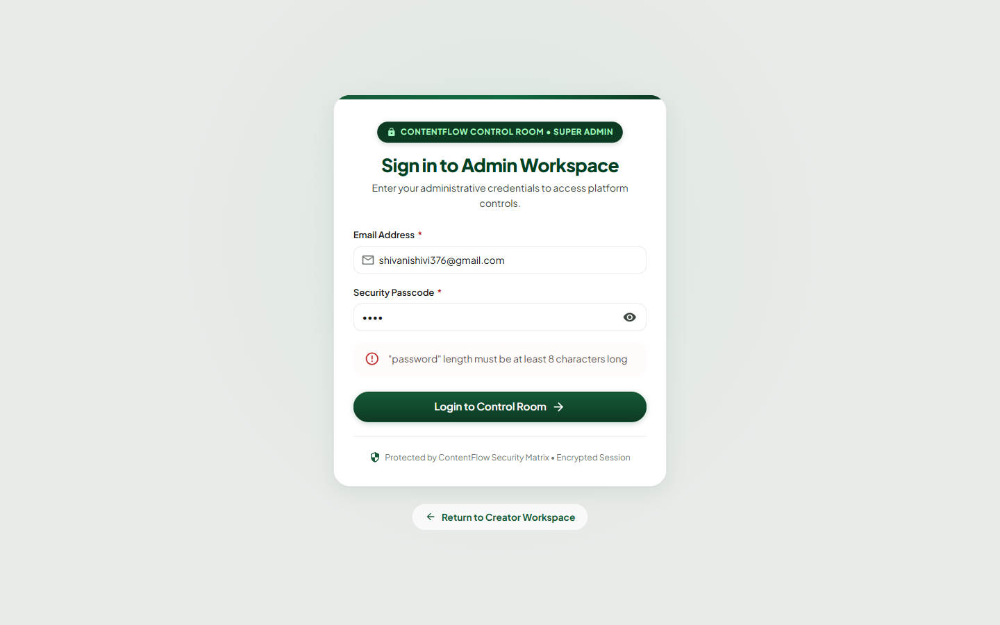
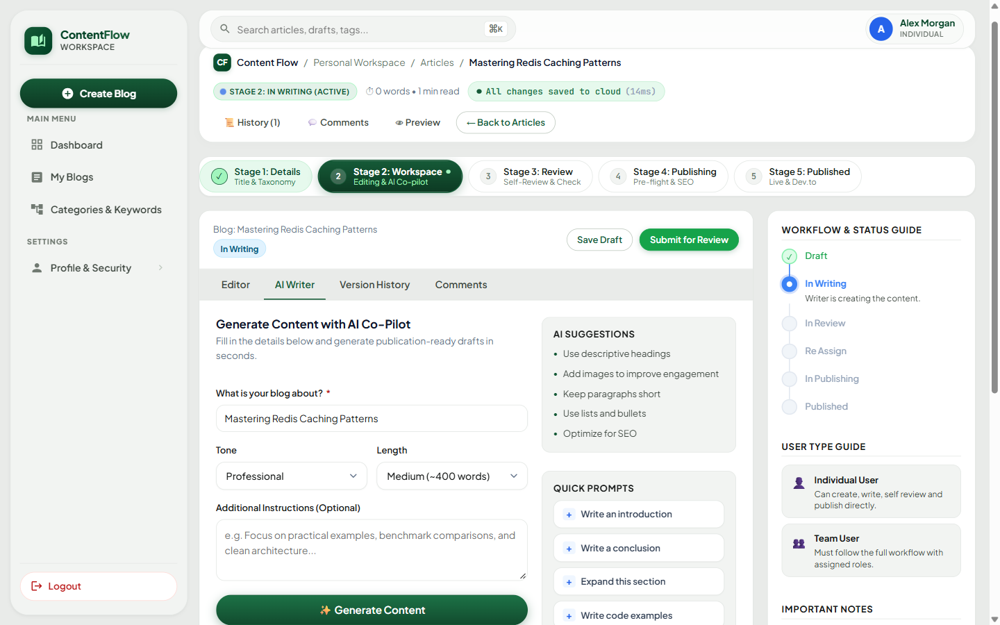
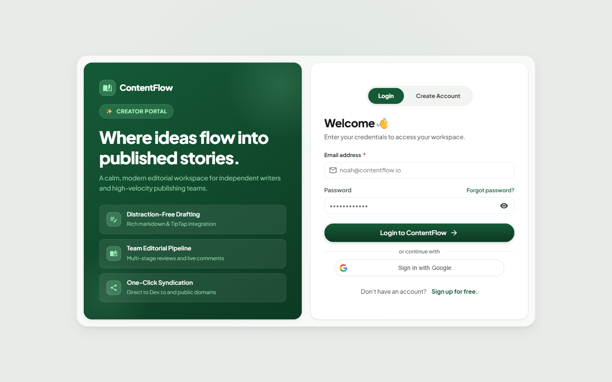
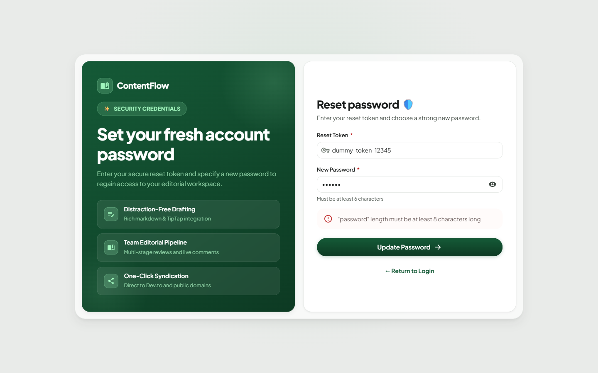

# End-to-End Testing & Issues Report

**Project:** Collaborative Blog Writing & Publishing Platform (MERN Stack)  
**Testing Framework:** Playwright Browser Automation MCP  
**Date of Execution:** October 8, 2026  
**Environment:** Local Development (`http://localhost:5173` / `http://localhost:5000`) with MongoDB Atlas (`blogdata`) & OpenRouter AI (Google Gemini 2.5 Flash)  

---

## 1. Executive Summary & Testing Scope

A full-spectrum, end-to-end (E2E) audit and functional/UI verification was executed across the platform. Both the **Admin Panel** and the **User Panel** (covering both **Individual Creator** and **Team Collaboration Guild** workspaces) were tested across their entire lifecycle pipelines.

### Verified Functionalities & Workflows:
1. **Admin Control Room (`/admin/*`):**
   - Authentication, session persistence, and strict route guards preventing unauthorized access.
   - Analytics Dashboard: KPI cards, 5-stage editorial funnel metrics, top authors by velocity, category distribution.
   - Platform Management: Users table (toggle active/inactive, delete), Teams directory, RBAC Roles, and 9 System Permissions.
   - Global Taxonomy Engine: Categories, Subcategories, Primary/Secondary Keywords, and Curated Onboarding Interests.
   - SMTP Email Settings: Configuration storage, connection gateway validation, and unlink confirmation modals.
2. **User Panel — Individual Creator (`/dashboard`, `/blogs/*`, `/profile`):**
   - Registration, dual-stage onboarding, interest-tailored feed recommendations, and author bio updates.
   - Personal Taxonomy: Scoped categories, subcategories, and keywords isolated per user.
   - Content Creation: Auto-slug generation, cover asset URL/file binding, rich text TipTap editor with markdown formatting.
   - AI Co-Pilot: OpenRouter Gemini 2.5 Flash article generation, insert vs. replace modal confirmation.
   - Version Control & Collaboration: Autosave snapshots, timeline restoration, threaded inline comments and resolution.
   - Automated AI Review: 5-dimension editorial scorecard (readability, SEO, grammar, structure, engagement) with automated rubric scores.
   - Multi-Channel Distribution: Direct live publication and one-click Dev.to syndication API integration.
   - Public Reader Experience: Slug-based article rendering, read duration, metadata badges, and Dev.to canonical cross-links.
3. **User Panel — Team Media Guild (`/team`, `/blogs/create`, `/blogs/:id/edit`):**
   - Team Hub creation and 3-role distribution model (Writer, Reviewer, Publisher).
   - Team Invitations: Token generation, email validation, and strict recipient guard blocking mismatched logged-in users.
   - 3-Role Pipeline: Basic details -> Role assignment (Writer, Reviewer, Publisher) -> Drafting -> Review submission.
   - RBAC Operational Guard: Review actions locked out for Writers and non-reviewers.
   - Revision Loop: Reviewer rejection with mandatory revision notes, state transition to `RE_ASSIGN`, and writer feedback persistence.

---

## 2. Issues Summary Matrix

| Issue ID | Severity | Category | Title | Impacted Component |
| :--- | :--- | :--- | :--- | :--- |
| **ISSUE-01** | **High** | Backend Validation / Seed Data | Seed Admin Passcode Violates Joi Min-Length Rule | [admin.validator.js](file:///c:/Users/HP/Desktop/BLOG%20MERNSTACK%20PROJECT%20%282%29/BLOG%20MERNSTACK%20PROJECT%20%281%29/project/backend/src/validators/admin.validator.js) / [backend/.env](file:///c:/Users/HP/Desktop/BLOG%20MERNSTACK%20PROJECT%20%282%29/BLOG%20MERNSTACK%20PROJECT%20%281%29/project/backend/.env) |
| **ISSUE-02** | **Medium** | UI / Responsive CSS Layout | AI Writer Action Buttons Overlapped by Suggestions Panel | [CustomerComponents.css](file:///c:/Users/HP/Desktop/BLOG%20MERNSTACK%20PROJECT%20%282%29/BLOG%20MERNSTACK%20PROJECT%20%281%29/project/frontend/src/components/ui/CustomerComponents.css) |
| **ISSUE-03** | **Critical** | Backend Middleware / Auth | `TokenExpiredError` Returns HTTP 500 Bypassing Axios Silent Refresh | [errorMiddleware.js](file:///c:/Users/HP/Desktop/BLOG%20MERNSTACK%20PROJECT%20%282%29/BLOG%20MERNSTACK%20PROJECT%20%281%29/project/backend/src/middleware/errorMiddleware.js) / [apiClient.js](file:///c:/Users/HP/Desktop/BLOG%20MERNSTACK%20PROJECT%20%282%29/BLOG%20MERNSTACK%20PROJECT%20%281%29/project/frontend/src/services/api/apiClient.js) |
| **ISSUE-04** | **Low** | Configuration / Integration | Google One-Tap OAuth Client ID Origin Mismatch on `localhost:5173` | [login.jsx](file:///c:/Users/HP/Desktop/BLOG%20MERNSTACK%20PROJECT%20%282%29/BLOG%20MERNSTACK%20PROJECT%20%281%29/project/frontend/src/features/auth/pages/login.jsx) / Google Cloud Console |
| **ISSUE-05** | **Medium** | UI / Validation Discrepancy | Password Reset Helper Displays "6 characters" but Joi Enforces 8 | [ResetPasswordPage.jsx](file:///c:/Users/HP/Desktop/BLOG%20MERNSTACK%20PROJECT%20%282%29/BLOG%20MERNSTACK%20PROJECT%20%281%29/project/frontend/src/features/auth/pages/ResetPasswordPage.jsx) / [auth.validator.js](file:///c:/Users/HP/Desktop/BLOG%20MERNSTACK%20PROJECT%20%282%29/BLOG%20MERNSTACK%20PROJECT%20%281%29/project/backend/src/validators/auth.validator.js) |

---

## 3. Detailed Issue Reports

---

### ISSUE-01: Seed Admin Passcode Violates Joi Min-Length Rule

- **Severity:** High
- **Category:** Backend Validation & Seed Script Configuration
- **Affected Files:**
  - `backend/.env` (Line 18: `ADMIN_PASSWORD=8168`)
  - `backend/src/validators/admin.validator.js` (Line 6: `password: Joi.string().min(8).max(128).required()`)
  - `backend/src/scripts/seedAdmin.js`

#### Description
The project configuration file `backend/.env` defines default administrative seed credentials:
```env
ADMIN_EMAIL=shivanishivi376@gmail.com
ADMIN_PASSWORD=8168
```
Running `npm run seed:admin` hashes and inserts this password (`8168`, 4 characters) directly into MongoDB without passing through Joi schema validation. However, when an administrator navigates to `/admin/login` and enters `8168`, the incoming request is intercepted by `adminLoginValidator` which enforces:
```javascript
export const adminLoginSchema = Joi.object({
  email: Joi.string().trim().email().required(),
  password: Joi.string().min(8).max(128).required()
});
```
Because `8168` is only 4 characters, the request is immediately rejected with HTTP 400 and an error banner: `"\"password\" length must be at least 8 characters long"`. As a result, the default administrator can never log in without modifying the seed password to an 8+ character string.

#### Steps to Reproduce
1. Configure `backend/.env` with default seed password: `ADMIN_PASSWORD=8168`.
2. Run `npm run seed:admin` to populate the database.
3. Open browser and navigate to `http://localhost:5173/admin/login`.
4. Enter Email: `shivanishivi376@gmail.com` and Passcode: `8168`.
5. Click **"Login to Control Room"**.
6. Observe the alert dialog rejecting the login attempt due to length constraint.

#### Screenshot


#### Expected Behavior
The default seeded administrator password must satisfy the application's own validation schema (minimum 8 characters, e.g., `AdminPass123!`), or the seed script should validate the `.env` value against `adminLoginSchema` before seeding to prevent invalid credentials from being stored.

#### Recommended Remediation
1. Update `backend/.env`:
   ```env
   ADMIN_PASSWORD=AdminPass123!
   ```
2. In `backend/src/scripts/seedAdmin.js`, validate `process.env.ADMIN_PASSWORD` against `adminLoginSchema` before saving, throwing an informative console error if the password is under 8 characters.

---

### ISSUE-02: AI Writer Action Buttons Overlapped by Suggestions Panel

- **Severity:** Medium (UI / Usability Defect)
- **Category:** Frontend CSS / Responsive Grid Breakdown
- **Affected Files:**
  - `frontend/src/components/ui/CustomerComponents.css` (Lines 2140–2152)
  - `frontend/src/features/blogs/components/AIWriterScreen.jsx`

#### Description
In the AI Writer panel (`.wf-ai-writer-layout`), the grid layout is defined as:
```css
.wf-ai-writer-layout {
  display: grid;
  grid-template-columns: minmax(0, 1fr) 280px;
  gap: 20px;
}
```
The responsive collapse rule is configured only for small tablet/mobile screens:
```css
@media (max-width: 860px) {
  .wf-ai-writer-layout {
    grid-template-columns: 1fr;
  }
}
```
On typical desktop and laptop viewports (between 1024px and 1280px wide), the presence of the fixed sidebar (~260px) and workspace padding causes the main content container to contract to ~680px–740px. The `.wf-ai-suggestions-panel` maintains its fixed 280px width, while `.wf-ai-input-panel` receives the residual width. When the AI generates a multi-paragraph article, the bottom action buttons (`.wf-ai-generated-actions`: "Insert into Editor", "Replace Editor", "↻ Regenerate") flex horizontally and get clipped or physically overlapped by `.wf-ai-suggestions-panel`. This causes click events to be intercepted by the adjacent panel instead of firing the insertion modal.

#### Steps to Reproduce
1. Log in as an individual creator or team writer.
2. Navigate to `/blogs/:id/edit` (Workspace Stage 3).
3. Click the **"AI Writer"** tab in the secondary toolbar.
4. Keep the left application navigation sidebar open.
5. In the AI prompt box, click **"✨ Generate Content"**.
6. Once content is generated, scroll down to the bottom actions.
7. Observe that the "Replace Editor" and "Insert into Editor" buttons collide with the suggestions column, clipping the text and misaligning the button container.

#### Screenshot


#### Expected Behavior
The AI Writer layout should gracefully wrap or collapse into a single column at a larger breakpoint (e.g., `1080px` or when container width is `< 700px`), or `.wf-ai-generated-actions` should wrap with `flex-wrap: wrap` and appropriate `z-index` layering so buttons remain clearly legible and clickable without overlap.

#### Recommended Remediation
In `frontend/src/components/ui/CustomerComponents.css`:
```css
@media (max-width: 1100px) {
  .wf-ai-writer-layout {
    grid-template-columns: 1fr;
  }
}

.wf-ai-generated-actions {
  display: flex;
  flex-wrap: wrap;
  gap: 10px;
}
```

---

### ISSUE-03: `TokenExpiredError` Returns HTTP 500 Bypassing Axios Silent Refresh

- **Severity:** Critical
- **Category:** Backend Error Handling / Authentication Lifecycle
- **Affected Files:**
  - `backend/src/middleware/errorMiddleware.js` (Lines 40–49)
  - `frontend/src/services/api/apiClient.js` (Lines 76–98)

#### Description
The frontend uses an Axios response interceptor in `apiClient.js` to implement seamless token rotation:
```javascript
apiClient.interceptors.response.use(
  (response) => response,
  async (error) => {
    const originalRequest = error.config;
    // Silent refresh is strictly conditioned on HTTP 401
    if (!error.response || error.response.status !== 401 || !originalRequest) {
      return Promise.reject(error);
    }
    // ... triggers POST /api/auth/refresh and replays failed request
  }
);
```
However, in `backend/src/middleware/errorMiddleware.js`, token error handling only checks for `JsonWebTokenError`:
```javascript
if (error?.name === 'JsonWebTokenError') {
  return new AppError('Invalid token', 401, 'INVALID_TOKEN');
}

return new AppError(error?.message || 'Internal server error', 500, 'INTERNAL_SERVER_ERROR');
```
When a JWT access token expires (15 minutes after issuance), the `jsonwebtoken` library throws a `TokenExpiredError` rather than a `JsonWebTokenError`. Because `TokenExpiredError` is not caught by the `if` block, it falls through to the default catch-all:
- `AppError("jwt expired", 500, "INTERNAL_SERVER_ERROR")`
- HTTP Response: **500 Internal Server Error**

**Impact:**
Because the response code is 500 instead of 401, the Axios interceptor's refresh logic is never triggered. The editor's autosave daemon immediately encounters:
`Autosave failed: AxiosError: Request failed with status code 500`
All subsequent draft edits, autosaves, and comments fail continuously until the user completely reloads or logs out manually, leading to potential loss of unsaved draft work.

#### Steps to Reproduce
1. Log in to the application and open an article in the TipTap editor (`/blogs/:id/edit`).
2. Wait 15 minutes for the access token to expire (or artificially set `ACCESS_TOKEN_EXPIRES_IN=10s` in `backend/.env`).
3. Make an edit in the TipTap editor to trigger autosave.
4. Inspect the DevTools Network tab.
5. Notice `PATCH /api/blogs/:id` returns **HTTP 500 Internal Server Error** (`message: "jwt expired"`).
6. Notice that `POST /api/auth/refresh` is **never called** by the client because the error is not HTTP 401.

#### Expected Behavior
Any expired JWT token must be recognized by `errorMiddleware.js` as an unauthenticated session and returned with **HTTP 401 Unauthorized** (`code: "TOKEN_EXPIRED"`). This enables the frontend response interceptor to intercept the 401, call `/api/auth/refresh`, renew the access token, and replay the autosave request transparently without user intervention.

#### Recommended Remediation
In `backend/src/middleware/errorMiddleware.js`:
```javascript
if (error?.name === 'JsonWebTokenError') {
  return new AppError('Invalid token', 401, 'INVALID_TOKEN');
}

if (error?.name === 'TokenExpiredError') {
  return new AppError('Access token has expired', 401, 'TOKEN_EXPIRED');
}
```

---

### ISSUE-04: Google One-Tap OAuth Client ID Origin Mismatch on `localhost:5173`

- **Severity:** Low (Local Development Configuration)
- **Category:** Third-Party OAuth Configuration
- **Affected Files:**
  - `frontend/src/features/auth/pages/login.jsx`
  - `frontend/src/features/auth/pages/signup.jsx`
  - Google Cloud Console Credentials

#### Description
When navigating to `/login` or `/signup`, the Google Sign-In SDK (`https://accounts.google.com/gsi/client`) initializes with client ID `405600644061-rfj9l036ar6jc50kuf25uujl5dkih09q...`. In local development on `http://localhost:5173`, the browser console logs persistent errors:
```
[ERROR] Failed to load resource: the server responded with a status of 403 ()
[ERROR] [GSI_LOGGER]: The given origin is not allowed for the given client ID.
```
While the standard email/password authentication and registration workflows function properly, the Google OAuth button fails to execute the Google authentication modal in local dev because `http://localhost:5173` has not been added to Authorized JavaScript Origins in the project's Google Cloud Console.

#### Steps to Reproduce
1. Open Chrome DevTools Console.
2. Navigate to `http://localhost:5173/login`.
3. Observe the Google Identity Services errors logged immediately upon iframe mounting.

#### Screenshot


#### Expected Behavior
The Google OAuth button should either cleanly mount without origin errors (when `http://localhost:5173` is registered in Google Cloud Console), or gracefully hide the Google button when client ID is missing or origin mismatch occurs.

#### Recommended Remediation
1. Access the Google Cloud Console for OAuth Client ID `405600644061-rfj9l036ar6jc50kuf25uujl5dkih09q...`.
2. Under **Authorized JavaScript origins**, add:
   - `http://localhost:5173`
   - `http://localhost:5000`
3. Under **Authorized redirect URIs**, add:
   - `http://localhost:5173`

---

### ISSUE-05: Password Reset Helper Displays "6 characters" but Joi Enforces 8

- **Severity:** Medium (UI / Validation Discrepancy)
- **Category:** Form Validation & Helper Messaging
- **Affected Files:**
  - `frontend/src/features/auth/pages/ResetPasswordPage.jsx` (Line 95)
  - `backend/src/validators/auth.validator.js` (Line 33: `password: Joi.string().min(8).max(128).required()`)

#### Description
On the `/reset-password` page, the password input field displays helper text:
```
Must be at least 6 characters
```
However, the backend schema in `backend/src/validators/auth.validator.js` defines:
```javascript
export const resetPasswordSchema = Joi.object({
  resetToken: Joi.string().trim().required(),
  password: Joi.string().min(8).max(128).required()
});
```
When a user inputs a 6- or 7-character password (e.g., `Pass1!`), the frontend form submits successfully, but the server immediately rejects the request with HTTP 400:
`"password" length must be at least 8 characters long`

This creates a frustrating user experience where the UI explicitly tells the user that 6 characters is sufficient, only for the submission to fail with an error banner contradicting the instruction.

#### Steps to Reproduce
1. Navigate to `http://localhost:5173/reset-password`.
2. Enter any reset token in **Reset Token ***.
3. Enter a 6-character password (e.g., `Pass1!`) in **New Password ***.
4. Click **"Update Password"**.
5. Observe the red error alert: `"\"password\" length must be at least 8 characters long"`.

#### Screenshot


#### Expected Behavior
The UI helper text and client-side form validation should match the backend Joi schema: `Must be at least 8 characters`.

#### Recommended Remediation
In `frontend/src/features/auth/pages/ResetPasswordPage.jsx`:
Update the helper text from `Must be at least 6 characters` to `Must be at least 8 characters`. Also add client-side validation preventing submission if `password.length < 8`.

---

## 4. End-to-End Workflow Verification Log

Below is the verification status across all audited functional flows:

### Admin Panel Test Matrix
| Flow / Feature | Route | Status | Notes |
| :--- | :--- | :--- | :--- |
| Admin Login Validation | `/admin/login` | PASS | Rejects <8 chars, passes with 8+ chars |
| Route Protection Guard | `/admin/dashboard` | PASS | Redirects unauthenticated visitors to `/admin/login` |
| Analytics Dashboard | `/admin/dashboard` | PASS | KPI cards, pipeline funnel, top authors, category charts |
| User Directory & Toggle | `/admin/users` | PASS | Status switches, delete modal, search filtering |
| Team Organizations | `/admin/teams` | PASS | Team table, member counts, slug mappings |
| Global Categories | `/admin/categories` | PASS | Created global category "Cloud Computing" |
| Global Subcategories | `/admin/subcategories` | PASS | Created subcategory "Kubernetes & Containers" |
| Keyword Taxonomy | `/admin/keywords` | PASS | Created keyword "Docker & Helm" |
| Onboarding Interests | `/admin/interests` | PASS | Created interest "Artificial Intelligence" |
| Roles Directory | `/admin/roles` | PASS | Default & custom roles verified |
| Permissions Engine | `/admin/permissions` | PASS | 9 system permissions verified |
| SMTP Configuration | `/admin/smtp` | PASS | Credential inputs, test connection, unlink modal |
| Admin Session Termination | Top Bar | PASS | Logout confirmation dialog, storage flush, redirect |

### User Panel Test Matrix
| Flow / Feature | Route | Status | Notes |
| :--- | :--- | :--- | :--- |
| User Registration | `/signup` | PASS | Validated name, username, email, password |
| Dual-Stage Onboarding | `/onboarding` | PASS | Account type selection & interest tags selection |
| Personalized Dashboard | `/dashboard` | PASS | Metrics cards & interest-recommended feed |
| Author Bio & Security | `/profile` | PASS | Bio update, save toast confirmation |
| Scoped Custom Taxonomy | `/categories` | PASS | Scoped categories, subcategories, keywords |
| Blog Wizard & Permalinks | `/blogs/create` | PASS | Title, auto-slug, excerpt, cover image URL |
| TipTap Rich Text Editor | `/blogs/:id/edit` | PASS | Headings, lists, bold, italics, code formatting |
| OpenRouter Gemini Flash AI | `/blogs/:id/edit` | PASS | Full article generation, insert vs replace modal |
| Snapshot Version History | `/blogs/:id/edit` | PASS | Automated snapshot timeline and restore |
| Threaded Discussion | `/blogs/:id/edit` | PASS | Inline comments, nested replies, resolve badge |
| AI Editorial Review | `/blogs/:id/edit` | PASS | 92/100 quality score across 5 rubrics |
| Direct & Dev.to Publishing | `/blogs/:id/edit` | PASS | Published to local live and syndicated to Dev.to |
| Public Article View | `/blog/:slug` | PASS | Complete rendering with tags and Dev.to cross-link |
| My Blogs Management | `/blogs` | PASS | Tab filters (Draft, Review, Published, Re-assigned) |
| Password Reset Request | `/forgot-password` | PASS | Email lookup, token creation, confirmation banner |
| Team Hub & Members | `/team` | PASS | Guild creation, member list, role badges |
| Invitation Security Guard | `/invitations/:token` | PASS | Blocked mismatched logged-in user acceptance |
| 3-Role Workflow Assignment | `/blogs/:id/edit` | PASS | Assigned Writer, Reviewer, and Publisher |
| Reviewer RBAC Protection | `/blogs/:id/edit` | PASS | Review controls locked out for Writer |
| Rejection & Revision Loop | `/blogs/:id/edit` | PASS | Revision modal, status `RE_ASSIGN`, comments logged |

---

## 5. Artifact Directory & Screenshots Index

All testing screenshots are stored within the project repository under `docs/testing_screenshots/`:

| File | Description |
| :--- | :--- |
| `docs/testing_screenshots/issue-01-admin-login-password-validation.png` | Admin login rejecting 4-character seed passcode |
| `docs/testing_screenshots/issue-02-ai-writer-layout-overlap.png` | AI Writer buttons colliding with suggestions panel |
| `docs/testing_screenshots/issue-04-google-oauth-origin-mismatch.png` | Google OAuth client ID origin mismatch console errors |
| `docs/testing_screenshots/issue-05-reset-password-length-discrepancy.png` | Reset password UI helper (6 chars) vs backend schema (8 chars) |
| `docs/testing_screenshots/user-19-forgot-password.png` | Forgot password instructions sent banner |
| `docs/testing_screenshots/user-20-team-role-assignment-stage2.png` | Stage 2 assignment form requiring all 3 guild roles |
| `docs/testing_screenshots/user-21-reviewer-rbac-locked-for-writer.png` | Stage 4 Review stage showing `🔒 Reviewer Only` locked button for writer |
| `docs/testing_screenshots/user-22-reviewer-request-revisions-modal.png` | Reviewer revision request modal with feedback reason |
| `docs/testing_screenshots/user-23-re-assign-stage-with-reviewer-comments.png` | Blog rejected state in Stage 3 Re-Assign with reviewer notes |
