# Functional Design Specification: Blog Module & Workflow

**Document:** `docs/blog-workflow-design.md`  
**System:** Collaborative Blog Writing & Publishing Platform  
**Target Audience:** Engineering, Product, QA, and Architecture Teams  
**Architecture Baseline:** React 18 + Vite + Redux Toolkit (Frontend), Node.js + Express + MongoDB Atlas + Mongoose (Backend)  
**Status:** Approved Functional Specification  

---

## Table of Contents

1. [Objective](#1-objective)
2. [User Types](#2-user-types)
3. [Individual User Flow](#3-individual-user-flow)
4. [Team User Flow](#4-team-user-flow)
5. [Blog CRUD Requirements](#5-blog-crud-requirements)
6. [Role Definitions and Permissions](#6-role-definitions-and-permissions)
7. [Status Lifecycle](#7-status-lifecycle)
8. [Status Transition Rules](#8-status-transition-rules)
9. [Re-Assign Workflow](#9-re-assign-workflow)
10. [Assignment Rules](#10-assignment-rules)
11. [Content & Editor Requirements](#11-content--editor-requirements)
12. [AI Assistance](#12-ai-assistance)
13. [Comments and Version History](#13-comments-and-version-history)
14. [Review and Approval Rules](#14-review-and-approval-rules)
15. [Publishing Rules](#15-publishing-rules)
16. [Third-Party Publishing (Dev.to)](#16-third-party-publishing-devto)
17. [Route & Navigation Requirements](#17-route--navigation-requirements)
18. [UI Behavior & Design Standards](#18-ui-behavior--design-standards)
19. [Backend & API Integration Requirements](#19-backend--api-integration-requirements)
20. [Acceptance Criteria](#20-acceptance-criteria)
21. [Edge Cases & Failure Handling](#21-edge-cases--failure-handling)
22. [Non-Breaking-Change Requirements](#22-non-breaking-change-requirements)

---

## 1. Objective

The **Blog Module** is the foundational core of the Collaborative Blog Writing & Publishing Platform. It delivers an end-to-end authoring, review, collaboration, version control, AI augmentation, and multi-channel publishing ecosystem.

The module solves two distinct operating models:
1. **Solo Creators (Individual Users)**: Require high-velocity content drafting, AI-assisted writing, automatic version history, rich media embedding, and instant single-click publishing without organizational friction.
2. **Collaborative Organizations (Team Users)**: Require a governed, multi-stage editorial workflow ensuring separation of concerns across authoring (**Writer**), editorial quality assurance (**Reviewer**), and final release authority (**Publisher**).

### Architectural Highlights
- **Frontend**: React 18, Vite, Redux Toolkit, TipTap Rich Text Suite, Lucide Icons, Vanilla CSS Custom Properties design system (`CustomerComponents.css`).
- **Backend**: Node.js, Express.js REST API with layered architecture (Controllers -> Services -> Repositories -> Models), JWT Session Management, and Role-Based Access Control (RBAC).
- **Persistence**: MongoDB Atlas with Mongoose ODM, maintaining relational integrity across Taxonomy, Blogs, Versions, Comments, Teams, and Users.
- **External Integrations**: OpenRouter LLM Gateway (AI Assistant), Cloudinary (Media CDN & Storage), Dev.to REST API (External Cross-Publishing), and Nodemailer / SMTP (Platform Notifications).

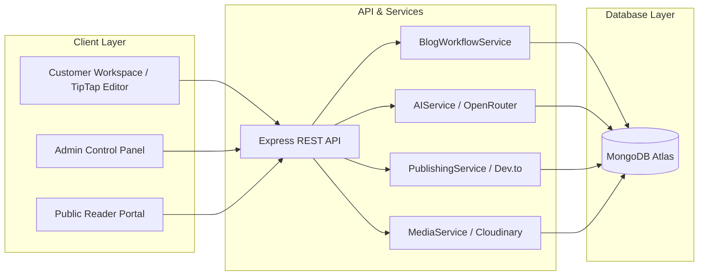

---

## 2. User Types

The platform recognizes four top-level user classifications:

| User Type | Account Context | Workflow Model | Primary Capabilities |
| :--- | :--- | :--- | :--- |
| **Individual User** | Personal (`accountType = "INDIVIDUAL"`) | Direct Fast-Track (`DRAFT -> PUBLISHED`) | Creates, edits, deletes, and self-publishes blogs. Full access to AI tools, auto-save, personal comments, and Dev.to syndication. No team assignment. |
| **Team User** | Team Member (`accountType = "TEAM"`) | Structured Editorial (`DRAFT -> IN_WRITING -> IN_REVIEW -> IN_PUBLISHING -> PUBLISHED`) | Participates in team blog lifecycles based on assigned workflow role (Writer, Reviewer, or Publisher) and administrative privileges (Team Owner). |
| **System Administrator** | Root Admin (`role = "ADMIN"`) | System Oversight & Governance | Single administrative tenant. Manages global taxonomy (Categories, Subcategories, Keywords), Interests, RBAC permissions, SMTP credentials, and platform-wide analytics. Does not participate in day-to-day writing unless configured. |
| **Public / Guest Reader** | Unauthenticated Reader | Read-Only Consumer | Discovers and reads published blogs via Public API (`/api/public/blogs`) and client reader routes (`/read`, `/blog/:slug`). Cannot view drafts, internal comments, or unpublished revisions. |

---

## 3. Individual User Flow

Individual creators operate with complete autonomy, bypassing editorial handoffs:

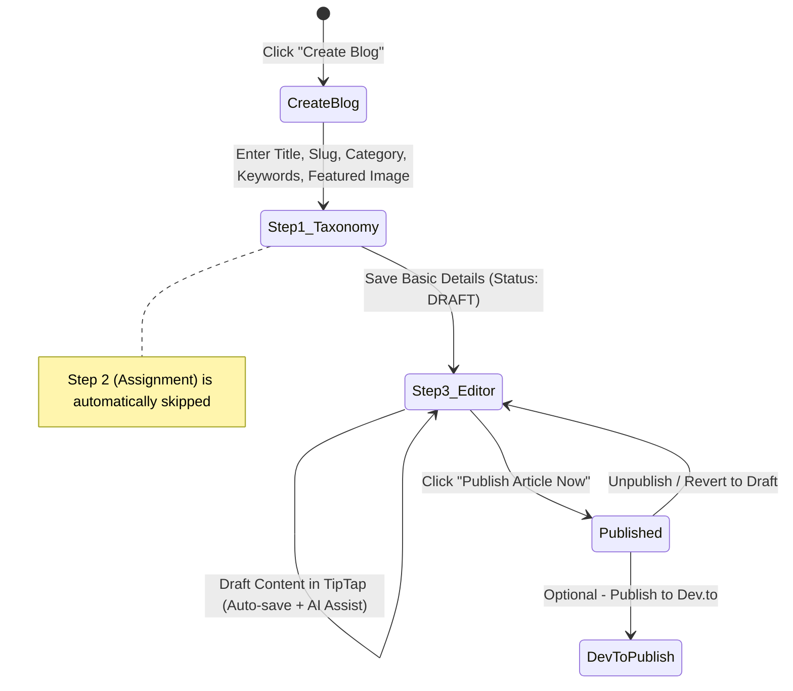

### Flow Specifications:
1. **Creation Initiation**: User selects **Create Blog** from the top bar or workspace navigation.
2. **Step 1 (Basic Details)**: User inputs Title, URL-safe Slug, Description, Category, Subcategory, Primary/Secondary Keywords, and uploads a Featured Image via Cloudinary.
3. **Step 2 Bypass**: Because `user.team` is absent, the multi-role assignment wizard step is omitted entirely.
4. **Step 3 (Content Workspace)**: The blog document is initialized with `status: "DRAFT"`. The user edits content in the TipTap editor with automated 2.5s debounced autosave and AI generation/refinement tools.
5. **Instant Publishing**: The user can immediately click **Publish Article Now** from the top workflow bar. The backend validates required content, updates status to `PUBLISHED`, records `publishedAt = new Date()`, and makes the article available on the public feed.
6. **Post-Publish Actions**: User can optionally cross-publish to **Dev.to** or unpublish back to `DRAFT`.

---

## 4. Team User Flow

Team blogs enforce a multi-agent separation of responsibilities to guarantee editorial quality and compliance:

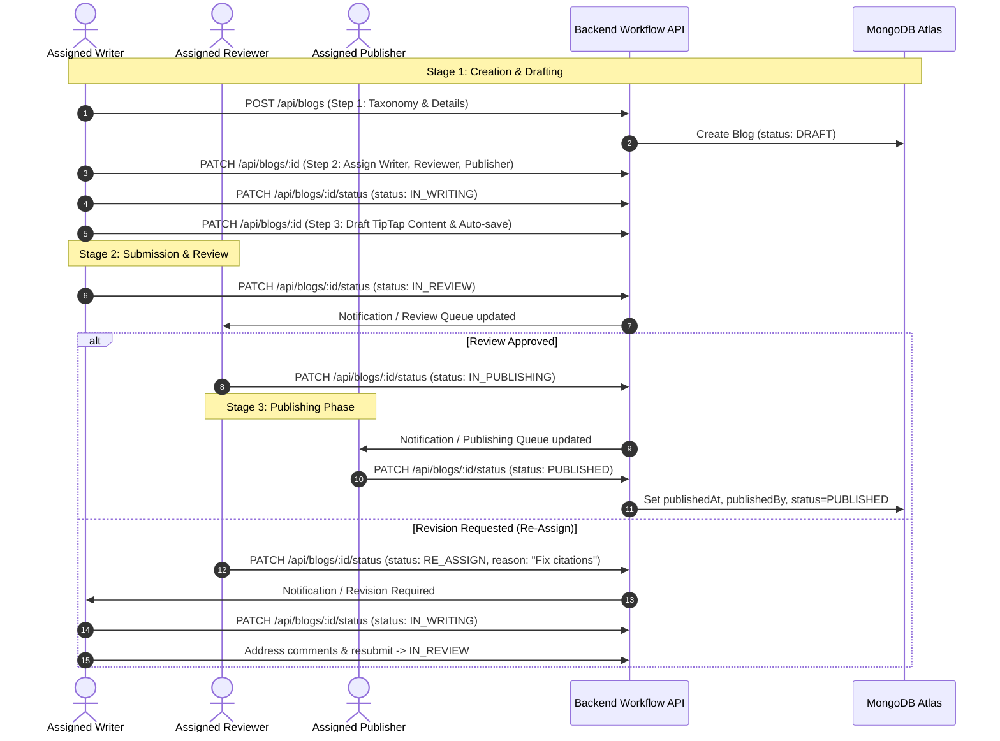

---

## 5. Blog CRUD Requirements

### 5.1 Create Blog (`POST /api/blogs`)
- **Step 1 — Basic Details**:
  - `title`: String (3 to 200 characters, required).
  - `slug`: URL-safe lowercase string, alphanumeric and hyphens only, globally unique (required).
  - `description`: String (max 500 characters, optional summary).
  - `category`: Valid active `Category` ObjectId (required).
  - `subcategory`: Valid active `Subcategory` ObjectId belonging strictly to the selected `category` (required).
  - `primaryKeywords`: Array of valid `Keyword` ObjectIds belonging to the selected `subcategory` (optional).
  - `secondaryKeywords`: Array of valid `Keyword` ObjectIds belonging to the selected `subcategory` (optional).
  - `featuredImage`: Cloudinary image URL (optional).
- **Step 2 — Workflow Assignment** (Team users only):
  - `writer`: User ObjectId (must have Writer permission and belong to team).
  - `reviewer`: User ObjectId (must have Reviewer permission and belong to team).
  - `publisher`: User ObjectId (must have Publisher permission and belong to team).
- **Step 3 — Content Editor**:
  - `content`: TipTap HTML/JSON representation.
  - `metadata.metaTitle`: String (max 70 characters).
  - `metadata.metaDescription`: String (max 160 characters).
- **Initial State**: Always initialized with `status: "DRAFT"` and a root `v1` version snapshot in `BlogVersion`.

### 5.2 Read / Query Blogs (`GET /api/blogs`, `GET /api/blogs/:id`)
- **Scoped Visibility Filtering**:
  - **Unauthenticated**: Only `status: "PUBLISHED"` blogs are accessible.
  - **Authenticated Individual**: Can view all public `PUBLISHED` blogs + their own blogs (any status).
  - **Authenticated Team Member**: Can view all public `PUBLISHED` blogs + all blogs belonging to their `team` (any status).
- **Search & Pagination**: Supports `page`, `limit`, `category`, `subcategory`, `status`, and text `search` indexing on Title and Description.

### 5.3 Update Blog (`PATCH /api/blogs/:id`)
- **Authorization Guard**: User must be the author, the assigned collaborator, or the Team Owner.
- **Dynamic Taxonomy Integrity**: Changing `category` or `subcategory` triggers strict backend validation ensuring all selected keywords belong to the new hierarchy.
- **Slug Modification**: Enforces unique constraint checking across all non-identical records.
- **Snapshot Triggering**: Automatically debounces and creates a new `BlogVersion` when content or key metadata changes significantly.

### 5.4 Delete Blog (`DELETE /api/blogs/:id`)
- **Authorization Guard**: Restricted to the original blog author or the Team Owner.
- **Cascading Cleanup**: Deletes associated comments (`Comment`), external publication records (`ExternalPublication`), and version snapshots (`BlogVersion`) or soft-flags them according to compliance configuration.

---

## 6. Role Definitions and Permissions

The system operates a decoupled, granular RBAC model where user capabilities are derived from assigned permissions rather than static string matching:

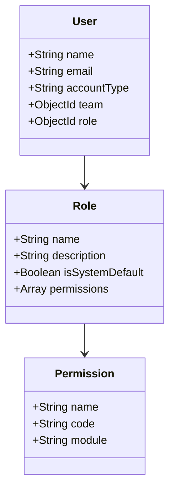

### Granular Permission Matrix

| Permission Code | Permission Description | Writer | Reviewer | Publisher | Team Owner | Individual | Admin |
| :--- | :--- | :---: | :---: | :---: | :---: | :---: | :---: |
| `BLOG_CREATE` | Initialize basic blog details & draft | ✅ | ❌ | ❌ | ❌* | ✅ | ✅ |
| `BLOG_EDIT` | Edit content, title, tags, and metadata | ✅ | ❌** | ❌ | ❌* | ✅ | ✅ |
| `BLOG_SUBMIT_REVIEW` | Transition status `IN_WRITING -> IN_REVIEW` | ✅ | ❌ | ❌ | ❌ | ✅ | ✅ |
| `BLOG_REVIEW` | Access review workspace & add feedback | ❌ | ✅ | ❌ | ❌* | ❌ | ✅ |
| `BLOG_APPROVE` | Transition status `IN_REVIEW -> IN_PUBLISHING`| ❌ | ✅ | ❌ | ❌ | ❌ | ✅ |
| `BLOG_REJECT` | Transition status `IN_REVIEW -> RE_ASSIGN` | ❌ | ✅ | ❌ | ❌ | ❌ | ✅ |
| `BLOG_PUBLISH` | Transition status `IN_PUBLISHING -> PUBLISHED`| ❌ | ❌ | ✅ | ❌* | ✅ | ✅ |
| `DEVTO_PUBLISH` | Trigger Dev.to external syndication | ❌ | ❌ | ✅ | ❌* | ✅ | ✅ |
| `COMMENT_MANAGE` | Create, reply, and resolve blog comments | ✅ | ✅ | ✅ | ✅ | ✅ | ✅ |
| `TEAM_MANAGE` | Invite, remove members, assign team roles | ❌ | ❌ | ❌ | ✅ | ❌ | ✅ |
| `TAXONOMY_MANAGE` | CRUD on Categories, Subcategories, Keywords | ❌ | ❌ | ❌ | ❌ | ❌ | ✅ |

*\* Note: The Team Owner possesses administrative control over team memberships and settings, but cannot execute editorial workflow actions (e.g., approve or publish) unless they hold the corresponding workflow role.*  
*\*\* Note: Reviewers cannot directly edit author text in the editor; they suggest revisions via comments or request revisions through `RE_ASSIGN`.*

---

## 7. Status Lifecycle

The blog module implements a strict 6-state state machine:

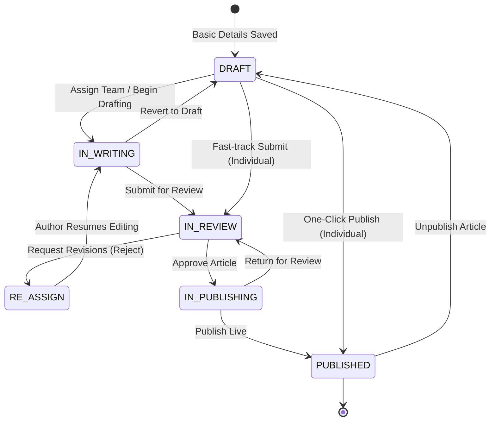

### State Definitions & Preconditions

| Status | Code Key | Meaning | Entry Preconditions | Allowed Next Statuses |
| :--- | :--- | :--- | :--- | :--- |
| **Draft** | `DRAFT` | Initial article setup. Taxonomy is defined; content is empty or initial draft. | Basic taxonomy valid; unique slug registered. | `IN_WRITING`, `IN_REVIEW`, `PUBLISHED` (Individual only) |
| **In Writing** | `IN_WRITING` | Writer is actively authoring or revising content in TipTap. | Writer assigned (or individual author). | `IN_REVIEW`, `DRAFT` |
| **In Review** | `IN_REVIEW` | Article is locked from major author edits and pending Reviewer evaluation. | Content length > 50 characters; Reviewer assigned. | `RE_ASSIGN`, `IN_PUBLISHING`, `IN_WRITING` |
| **Re-Assigned** | `RE_ASSIGN` | Reviewer requested mandatory revisions with feedback comment. | Rejection reason/comment provided by Reviewer. | `IN_WRITING` |
| **In Publishing** | `IN_PUBLISHING` | Article content is finalized and approved; awaiting Publisher release. | Approved by Reviewer; required SEO metadata present. | `PUBLISHED`, `IN_REVIEW` |
| **Published** | `PUBLISHED` | Live and accessible on the Public API and reader portal. | Valid slug; non-empty content; published by authorized role. | `DRAFT` (Unpublish) |

---

## 8. Status Transition Rules

All status transitions are processed via `PATCH /api/blogs/:id/status` and executed through `blogWorkflowService.js`.

### Deterministic Transition Map (`ALLOWED_TRANSITIONS`)

```javascript
export const ALLOWED_TRANSITIONS = {
  [BLOG_STATUS.DRAFT]: [BLOG_STATUS.IN_WRITING, BLOG_STATUS.IN_REVIEW, BLOG_STATUS.PUBLISHED],
  [BLOG_STATUS.IN_WRITING]: [BLOG_STATUS.IN_REVIEW, BLOG_STATUS.DRAFT],
  [BLOG_STATUS.IN_REVIEW]: [BLOG_STATUS.RE_ASSIGN, BLOG_STATUS.IN_PUBLISHING, BLOG_STATUS.IN_WRITING],
  [BLOG_STATUS.RE_ASSIGN]: [BLOG_STATUS.IN_WRITING],
  [BLOG_STATUS.IN_PUBLISHING]: [BLOG_STATUS.PUBLISHED, BLOG_STATUS.IN_REVIEW],
  [BLOG_STATUS.PUBLISHED]: [BLOG_STATUS.DRAFT]
};
```

### Execution & Audit Trail Rules:
1. **Transition Validation**: If `isValidTransition(currentStatus, targetStatus)` evaluates to `false`, the API terminates immediately with `400 Bad Request` (`INVALID_WORKFLOW_TRANSITION`).
2. **Payload Enrichment**:
   - Transitioning to `PUBLISHED` automatically sets `publishedAt = new Date()` and `publishedBy = user._id`.
   - Transitioning with an `assignedUser` payload updates the corresponding role pointer (`writer`, `reviewer`, or `publisher`).
3. **Automated Audit Snapshot**: Every successful transition automatically triggers `createVersionSnapshot(updatedBlog, user._id, changeSummary)`, logging the exact status delta, timestamp, and optional reason (e.g., `"Status transitioned: IN_REVIEW -> RE_ASSIGN (Fix code samples)"`).

---

## 9. Re-Assign Workflow

When an article does not meet editorial standards, the Reviewer initiates the **Re-Assign Workflow**:

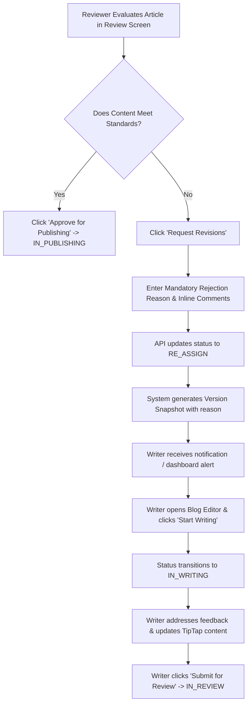

### Protocol Requirements:
1. **Mandatory Rationale**: The UI displays a modal requiring the Reviewer to specify why the blog was rejected. The API rejects requests to `RE_ASSIGN` lacking a valid `reason` string.
2. **Context Retention**: All comments logged during the review remain threaded in the **Comments Panel** with status flags (`OPEN` vs `RESOLVED`).
3. **Workspace State**: Upon receiving `RE_ASSIGN`, the Writer's editor unlocks full write permissions. The workflow bar displays a danger-accented **Re-assigned** badge and presents the primary action: **Start Writing**.

---

## 10. Assignment Rules

Team blog creation includes a dedicated assignment phase (Step 2) to establish the chain of custody:

1. **Intra-Team Boundary**:
   - All assigned users (`writer`, `reviewer`, `publisher`) must belong to the same active `team` ID as the blog.
   - Assignment of external users or non-team members is strictly blocked with `400 Bad Request` (`INVALID_TEAM_ASSIGNMENT`).
2. **Role Capability Validation**:
   - The user assigned as `writer` must hold the `Writer` role/permission.
   - The user assigned as `reviewer` must hold the `Reviewer` role/permission.
   - The user assigned as `publisher` must hold the `Publisher` role/permission.
3. **Self-Assignment**:
   - If a user holds multiple roles (e.g., Team Owner who is also a Writer and Publisher), they may be assigned to multiple positions on the same blog.
4. **Orphan Prevention**:
   - If a team member is removed from the team while actively assigned to a blog in progress, the blog remains in its current status, but cannot transition to the next stage until the Team Owner reassigns an active member.

---

## 11. Content & Editor Requirements

The content editing experience is powered by **TipTap** (headless ProseMirror wrapper for React) configured in `frontend/src/features/editor`:

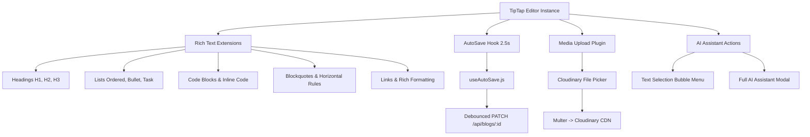

### Feature Specifications:
- **Rich Text Tooling**: Headings (H1–H3), Paragraphs, Bold, Italic, Strikethrough, Ordered/Unordered Lists, Blockquotes, Inline Code, Syntax-highlighted Code Blocks, Hyperlinks, and Tables.
- **Image Uploading**: Seamless image insertion into content body. Images are sent as `multipart/form-data` to `/api/media/upload`, stored on **Cloudinary**, and injected into TipTap as responsive `` nodes with CDN URLs.
- **Auto-Save Engine**:
  - Managed by custom hook `useAutoSave(formData, handleSave, 2500)`.
  - Debounced at **2.5 seconds** after user keystrokes stop.
  - Visual status pill indicators: `● Saving...` (yellow), `✓ Saved` (green), or `✕ Save Error` (red).
- **SEO & Metadata Fields**:
  - `metaTitle`: Displayed under SEO drawer, validated for search engine length (optimal 50–60 chars).
  - `metaDescription`: Validated for optimal snippet length (120–160 chars).
  - `authorName`: Displays customized public author attribution.

---

## 12. AI Assistance

AI capabilities are integrated via **OpenRouter** API, abstracted behind a backend `AIService`:

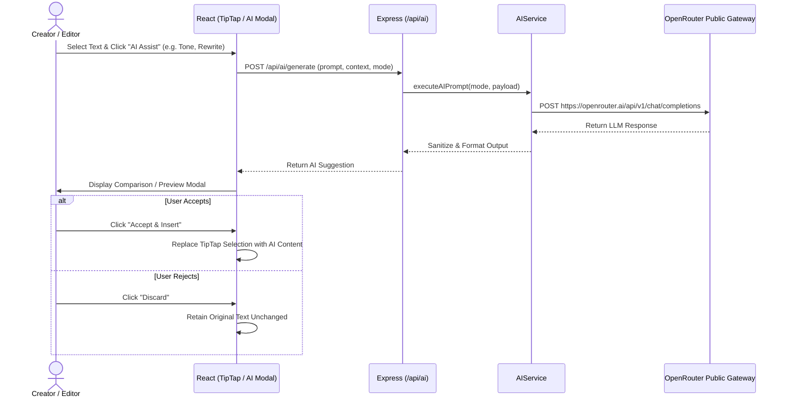

### AI Capability Catalog

| Capability Mode | Trigger Context | Description |
| :--- | :--- | :--- |
| **Generate Content** | Modal / Empty Document | Generates full article outlines or draft sections from a user prompt. |
| **Continue Writing** | Cursor Position | Extrapolates current narrative, maintaining style and context. |
| **Improve Writing** | Selection Bubble Menu | Corrects grammar, improves clarity, and enhances vocabulary. |
| **Rewrite & Rephrase** | Selection Bubble Menu | Rephrases sentences for improved rhythm and readability. |
| **Expand Text** | Selection Bubble Menu | Adds depth, examples, and technical explanations to selected text. |
| **Shorten / Summarize** | Selection Bubble Menu | Condenses lengthy paragraphs into punchy summaries. |
| **Change Tone** | Selection Bubble Menu | Adapts style (Professional, Casual, Academic, Enthusiastic, Persuasive). |
| **Generate SEO Metadata** | SEO Sidebar Drawer | Generates optimized Title Tags, Meta Descriptions, and Keywords based on full content. |

> **Critical Safety Rule**: AI suggestions are **never applied destructively or automatically**. The user is always presented with a side-by-side diff preview and must explicitly click **Accept** to apply changes.

---

## 13. Comments and Version History

### 13.1 Threaded Blog Comments
- **Scope**: General blog-level discussions, review remarks, and revision requests.
- **Data Model (`Comment`)**:
  - `blog`: Reference to `Blog`.
  - `author`: Reference to `User`.
  - `content`: String (required, max 1000 characters).
  - `parentComment`: Optional self-reference for 1-level replies.
  - `isResolved`: Boolean (default `false`).
- **Capabilities**:
  - Create comment / reply.
  - Edit/Delete own comments.
  - Mark as Resolved / Reopen (accessible to Reviewers, Authors, and Publishers).

### 13.2 Automatic Version History
- **Data Model (`BlogVersion`)**:
  - `blog`: Reference to `Blog`.
  - `versionNumber`: Auto-incrementing integer (`v1`, `v2`, `v3`...).
  - `title`, `description`, `content`, `featuredImage`, `metadata`: Exact state snapshot.
  - `createdBy`: User ObjectId who triggered the snapshot.
  - `changeSummary`: Human-readable description of change (e.g. `"Autosave snapshot"`, `"Status transitioned: IN_REVIEW -> IN_PUBLISHING"`, `"Restored from v2"`).
- **Restoration Paradigm**: Restoring an old version (e.g. restoring `v2` when at `v5`) **does not overwrite or delete history**. It creates a brand new snapshot `v6` containing `v2`'s state.

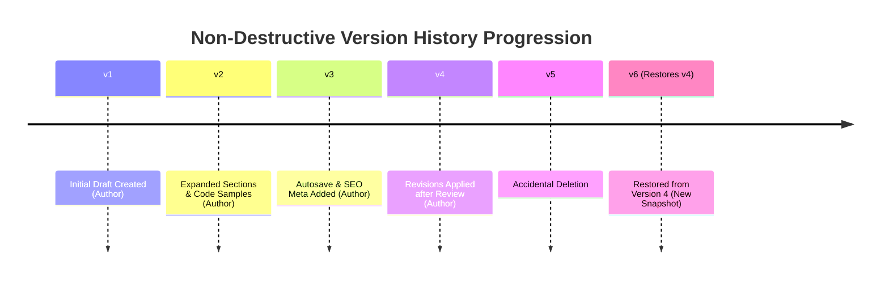

---

## 14. Review and Approval Rules

The Review stage serves as the quality checkpoint for Team blogs:

1. **Review Workspace Access**:
   - Triggered when blog status is `IN_REVIEW`.
   - Reviewers access the article via `/blogs/:id/edit` (or dedicated review view). Content is rendered in a clean, distraction-free reading mode with comment tools enabled.
2. **Pre-Approval Validation Checklist**:
   - [x] Primary Category and Subcategory properly assigned.
   - [x] Content body meets minimum threshold (> 100 words).
   - [x] Slug is URL-safe and collision-free.
   - [x] All critical review comments marked as **Resolved**.
3. **Approval Action**:
   - Reviewer clicks **Approve for Publishing**.
   - API verifies Reviewer permissions and transitions status: `IN_REVIEW -> IN_PUBLISHING`.
   - Publisher is alerted that an article is ready for release.

---

## 15. Publishing Rules

The final release of articles to the public web is governed by strict release controls:

### Release Requirements
1. **Authorization**:
   - Individual blogs: Published directly by the author.
   - Team blogs: Published exclusively by the assigned **Publisher** (or Admin).
2. **State Gate**: Blog must be in `IN_PUBLISHING` (Team) or `DRAFT` (Individual).
3. **Execution Payload**:
   - Sets `status: "PUBLISHED"`.
   - Sets `publishedAt: new Date()`.
   - Sets `publishedBy: user._id`.
4. **Public Surface Indexing**:
   - The blog immediately becomes queryable through the read-only public endpoints:
     - `GET /api/public/blogs`
     - `GET /api/public/blogs/:slug`
     - `GET /api/public/blogs/category/:categorySlug`
   - Public responses strip internal draft fields, comments, version lists, and team identifiers.

---

## 16. Third-Party Publishing (Dev.to)

For external content distribution, the platform integrates natively with **Dev.to**:

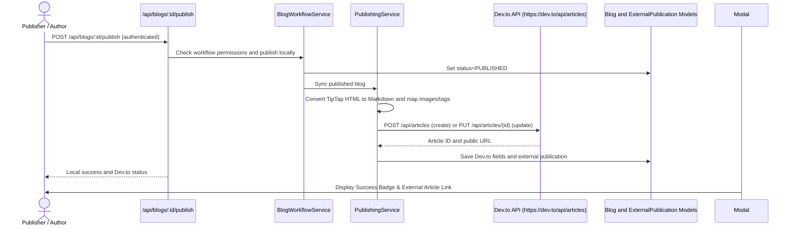

### Dev.to Technical Specifications:
- **Markdown Conversion**: Converts TipTap rich text HTML into valid GitHub-flavored Markdown.
- **Canonical URL Integrity**: Sets `canonical_url` to `https://<domain>/blog/<slug>` to ensure the platform retains primary SEO ranking authority.
- **Tag Extraction**: Maps primary and secondary keywords into Dev.to lowercase alpha tags (max 4 tags).
- **Tracking**: Creates a permanent record in `ExternalPublication` collection storing `externalId`, `url`, `publishedAt`, and API metadata.

---

## 17. Route & Navigation Requirements

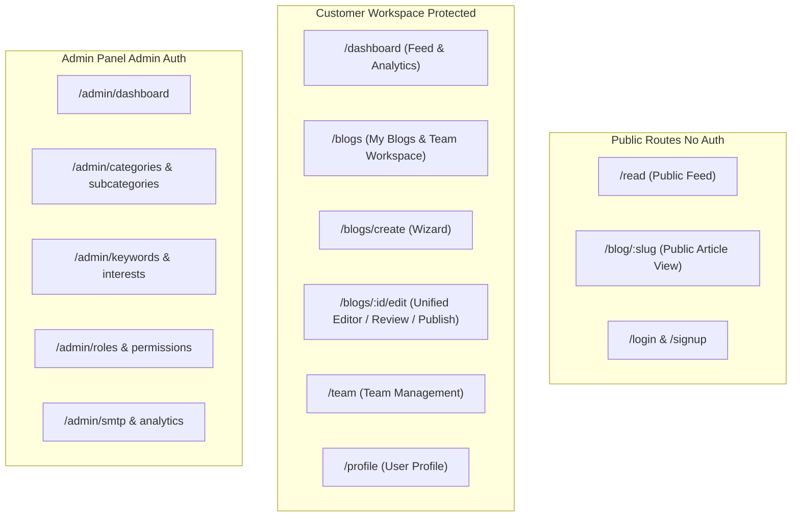

### Customer Route Inventory

| Path | Layout Guard | Component | Functionality |
| :--- | :--- | :--- | :--- |
| `/read` | Public | `PublicBlogFeedPage` | Filterable discovery feed of published articles. |
| `/blog/:slug` | Public | `PublicBlogDetailPage` | Full reader view of published blog post. |
| `/dashboard` | `ProtectedRoute` + `CustomerLayout` | `DashboardFeedPage` | Personalized article feed based on user interests, quick metrics. |
| `/blogs` | `ProtectedRoute` + `CustomerLayout` | `BlogsListPage` | Workspace listing of all author/team drafts, in-progress, and published blogs. |
| `/blogs/create` | `ProtectedRoute` + `CustomerLayout` | `BlogCreatePage` | Multi-step wizard (Basic Details -> Assignment -> Editor). |
| `/blogs/:id/edit`| `ProtectedRoute` + `CustomerLayout` | `BlogEditPage` | Unified workspace: TipTap editor, AutoSave, Workflow Bar, AI Assistant, Comments, Version History, Dev.to modal. |
| `/team` | `ProtectedRoute` + `CustomerLayout` | `TeamDashboardPage` | Team member list, role invite links, SMTP invite dispatch. |
| `/profile` | `ProtectedRoute` + `CustomerLayout` | `ProfilePage` | User bio, avatar upload, password change, interest preferences. |

---

## 18. UI Behavior & Design Standards

The presentation layer follows the **SaaS Creator Workspace** design system defined in `DESIGN_REQUIREMENTS.md` and `CustomerComponents.css`:

### 18.1 Color & Surface Palette
- **Brand Accent**: Indigo/Royal Blue (`--color-primary: #2563eb`, hover `--color-primary-hover: #1d4ed8`).
- **Surfaces**: Crisp white card surfaces (`--color-surface-card: #ffffff`) over soft slate backgrounds (`--color-bg-app: #f8fafc`) with subtle borders (`--color-border-default: #e2e8f0`).
- **Typography**: `Inter, system-ui, sans-serif` with high contrast headers (`--color-text-main: #0f172a`) and slate body text (`--color-text-body: #334155`).

### 18.2 Workflow Badges & Visual Indicators

| Status Key | Badge Label | Background Token | Text Color |
| :--- | :--- | :--- | :--- |
| `DRAFT` | `Draft` | `#f1f5f9` (Neutral Gray) | `#475569` |
| `IN_WRITING` | `In Writing` | `#dbeafe` (Light Blue) | `#1e40af` |
| `IN_REVIEW` | `In Review` | `#fef3c7` (Light Amber) | `#92400e` |
| `RE_ASSIGN` | `Re-assigned` | `#fee2e2` (Light Red) | `#dc2626` |
| `IN_PUBLISHING`| `In Publishing` | `#f3e8ff` (Light Purple) | `#6b21a8` |
| `PUBLISHED` | `Published` | `#dcfce7` (Light Emerald) | `#166534` |

### 18.3 Interactive Elements
- **WorkflowActionsBar**: Positioned at the top of `/blogs/:id/edit`, displaying current status badge, contextual action buttons, and transition loading spinners.
- **Drawers & Modals**: Smooth slide-over drawers for **Version History** and **Comments Panel**; backdrop-blurred centered modals for **AI Assistant** and **Dev.to Publishing**.
- **Responsive Adaptability**: Full desktop 3-pane workflow adapting to collapsible drawer views on mobile and tablet screen sizes.

---

## 19. Backend & API Integration Requirements

### 19.1 API Endpoints Specification

```http
### Blog Core Endpoints
POST   /api/blogs                     -> Create new blog record (auth required)
GET    /api/blogs                     -> List user/team blogs with query filters (auth required)
GET    /api/blogs/:id                 -> Retrieve single blog by ID (auth required)
PATCH  /api/blogs/:id                 -> Update blog content/metadata (auth required)
DELETE /api/blogs/:id                 -> Delete blog (author/owner only)

### Workflow & Transitions
PATCH  /api/blogs/:id/status          -> Transition status { status, reason, assignedUser }

### Version Control
GET    /api/blogs/:id/versions        -> Retrieve version snapshot list
GET    /api/blogs/:id/versions/:vId   -> Retrieve specific version details
POST   /api/blogs/:id/versions/:vId/restore -> Non-destructive snapshot restore

### External Publishing
POST   /api/blogs/:id/publish/devto   -> Publish article to Dev.to
GET    /api/blogs/:id/external-publications -> Retrieve external publication history

### Comments
GET    /api/comments/blog/:blogId     -> List threaded comments for blog
POST   /api/comments                  -> Create new comment or reply
PATCH  /api/comments/:id              -> Edit comment or resolve status
DELETE /api/comments/:id              -> Delete comment

### Public Reader API
GET    /api/public/blogs              -> Public paginated feed of published blogs
GET    /api/public/blogs/:slug        -> Public article retrieval by unique slug
GET    /api/public/categories         -> Public active category listing
```

### 19.2 Middleware Architecture Stack
1. `authMiddleware`: Extracts and validates JWT access token from Authorization header or cookie.
2. `validateRequest(schema)`: Validates request body against strict Joi/Zod schema before controller execution.
3. `rbacMiddleware(permissionCode)`: Asserts authenticated user has required role permission.
4. `errorHandler`: Global error handling middleware normalizing responses into `{ success: false, message, code }`.

---

## 20. Acceptance Criteria

| ID | Module / Feature | Acceptance Criterion | Verification Method |
| :--- | :--- | :--- | :--- |
| **AC-01** | Taxonomy Validation | Submitting a blog with keywords from an unrelated subcategory returns `400 Bad Request`. | API Test / Schema Validation |
| **AC-02** | Slug Uniqueness | Registering a duplicate slug returns `409 Conflict`. | Unique Index / Integration Test |
| **AC-03** | Individual Flow | Individual users can transition directly from `DRAFT` to `PUBLISHED`. | End-to-End Workflow Test |
| **AC-04** | Team Workflow Integrity | Team blogs cannot bypass intermediate statuses (`DRAFT -> PUBLISHED` directly is blocked). | Transition Matrix Test |
| **AC-05** | Re-Assign Flow | Reviewer rejection without a `reason` payload is blocked. Transition sets status to `RE_ASSIGN`. | Unit / Service Test |
| **AC-06** | Auto-Save Engine | Form edits in TipTap auto-save after 2500ms of inactivity without blocking UI thread. | Frontend UI Test |
| **AC-07** | Non-Destructive Restore| Restoring `v2` on a blog with `v5` creates `v6` containing `v2` content without deleting `v1-v5`. | Version History Test |
| **AC-08** | AI Integration | AI suggestions are displayed in a diff preview; TipTap content only updates upon clicking **Accept**. | UI Interaction Test |
| **AC-09** | Dev.to Syndication | Publishing to Dev.to converts HTML to Markdown, attaches canonical URL, and creates `ExternalPublication`. | External Mock Test |
| **AC-10** | Public Scoping | `GET /api/public/blogs` never returns blogs with status other than `PUBLISHED`. | Security & Query Test |

---

## 21. Edge Cases & Failure Handling

1. **Concurrent Editing**:
   - *Risk*: Two team members editing the same blog simultaneously overwrite each other's changes.
   - *Handling*: Debounced autosave compares `updatedAt` timestamps. If a stale update is detected, the server returns `409 Conflict`, prompting the user to refresh and compare with version history.
2. **Team Member Removal Mid-Workflow**:
   - *Risk*: An assigned Reviewer is removed from the team while an article is in `IN_REVIEW`.
   - *Handling*: The blog status remains `IN_REVIEW`. The Team Owner receives an alert on the team dashboard to re-assign an active team member to the Reviewer position.
3. **Taxonomy Deactivation**:
   - *Risk*: Admin deactivates a Category while blogs under it are in `DRAFT`.
   - *Handling*: Existing drafts retain references, but attempting to save new edits requires re-selecting an active Category.
4. **Dev.to API Failure / Rate Limits**:
   - *Risk*: External API timeout or rate limit during syndication.
   - *Handling*: Express controller catches external 429/500 errors, logs failure in `ExternalPublication` with status `FAILED`, and returns a user-friendly error toast without affecting local `PUBLISHED` status.
5. **OpenRouter AI Quota Exceeded**:
   - *Risk*: AI provider returns error or exhausted quota.
   - *Handling*: `AIService` catches the failure and returns a structured message: `"AI Assistant is currently unavailable. Your existing draft is safely preserved."`

---

## 22. Non-Breaking-Change Requirements

To maintain backward compatibility with existing V1 and V2 implementations:

1. **Zero Database Destructive Operations**:
   - Schema additions must be optional fields (`default: null` or `default: []`).
   - Existing collections (`blogs`, `blogversions`, `comments`, `users`, `teams`, `categories`) must not rename or drop existing fields.
2. **API Contract Preservation**:
   - Existing endpoints (`/api/blogs`, `/api/blogs/:id`, `/api/blogs/:id/status`) must preserve existing request/response shapes.
   - Extended response data must be additive (new nested keys without altering legacy keys).
3. **Route & Component Isolation**:
   - All existing route paths (`/blogs`, `/blogs/create`, `/blogs/:id/edit`, `/read`, `/dashboard`) remain intact.
   - Design system enhancements must reside cleanly in presentation styling (`CustomerComponents.css`, `index.css`) without mutating underlying Redux dispatch actions or state trees.
