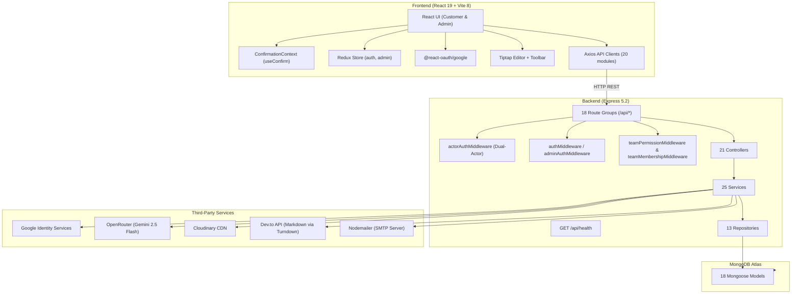
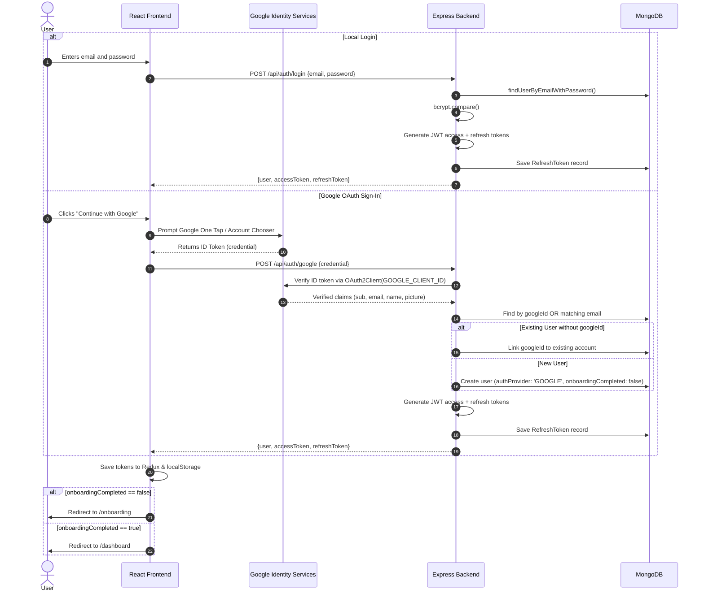

# 📝 Collaborative Blog Writing & Publishing Platform — Complete Documentation

---

## 1. What This Project Does (Simple Overview)

This is a **full-stack blog platform** where users can create, write, review, and publish blog articles. It is built for both **individual writers** and **collaborative teams**.

**Key features and capabilities:**
- **Individual users** can write, edit, and publish blogs directly with complete ownership.
- **Teams** collaborate with a multi-step editorial workflow: **Writer → Reviewer → Publisher** (modelled like an editorial newsroom).
- **Dual Authentication**: Local email/password authentication (with JWT access and refresh token rotation) AND **Google OAuth Sign-In** (Google Identity Services ID-token verification with automatic account provisioning and account linking).
- **AI assistant** (powered by OpenRouter API / Google Gemini) capable of drafting complete articles, rewriting/expanding/shortening text, and generating SEO metadata, with graceful local mock fallbacks.
- **Rich text editor** (Tiptap) with full formatting (headings, lists, blockquotes, code blocks, links, and Cloudinary-backed image uploads).
- **Three-Level Scoped Taxonomy Hierarchy**: Categories → Subcategories → Keywords supporting **Global** (system/admin), **Individual** (personal), and **Team** scopes, manageable by both Admins and normal Users.
- **User Category Management**: Dedicated frontend workspace (`/categories`) for users and teams to create and manage their own taxonomy tags.
- **Admin Panel** managing platform analytics, categories, subcategories, keywords, interests, users, teams, SMTP email settings (including test emails and config unlinking), roles, and permissions.
- **Dev.to Cross-Publishing**: One-click and modal-based publishing to Dev.to with HTML-to-Markdown conversion, custom tags, and complete publication tracking.
- **Threaded Review Comments**: Blog comments supporting parent-child reply threading, status toggling (`OPEN` / `RESOLVED`), and role enforcement ensuring only Reviewers publish review feedback on team blogs.
- **Full Version History**: Immutable snapshots created on autosaves, workflow transitions, and role assignments, with one-click restoration that preserves full audit trails.
- **Global Confirmation Modal System**: Unified `useConfirm()` dialogs for critical actions like logout, deletions, and unlinking configs.

---

## 2. Tech Stack

| Layer | Technology | Version | Purpose |
|---|---|---|---|
| **Frontend Framework** | React | 19.2.8 | User interface components |
| **Build Tool** | Vite | 8.2.0 | Development server and bundle tooling |
| **State Management** | Redux Toolkit | 2.12.0 | Centralized application state (`auth`, `admin`) |
| **Routing** | React Router DOM | 7.18.2 | Client-side routing and protected route guards |
| **UI Libraries** | Material UI (MUI) 9.3.1 + Bootstrap 5.3.8 | Latest | Themed interactive components and responsive layouts |
| **Rich Text Editor** | Tiptap | 3.30.1 | Headless extensible rich text editor |
| **HTTP Client** | Axios | 1.19.0 | Centralized REST client with Bearer token injection |
| **Google Sign-In (FE)** | @react-oauth/google | 0.13.5 | Google Identity Services button and credential handling |
| **Backend Framework** | Express.js | 5.2.1 | REST API framework (ES Modules) |
| **Database** | MongoDB (via Mongoose 9.9.2) | 9.9.2 | Schema validation, indexes, and document queries |
| **Auth & Security** | JWT (jsonwebtoken 9.0.3) + bcryptjs 3.0.3 | Latest | Access/refresh token lifecycle and password hashing |
| **Google Auth (BE)** | google-auth-library | 11.1.0 | Server-side Google ID token verification |
| **AI Integration** | OpenRouter API (Google Gemini 2.5 Flash) | Latest | Generative writing, text refinement, SEO suggestions |
| **File Uploads** | Cloudinary + Multer | 2.10.0 / 2.2.0 | In-memory upload stream to cloud media storage |
| **Markdown Conversion**| Turndown | 7.2.4 | HTML-to-Markdown conversion for Dev.to publishing |
| **Email Delivery** | Nodemailer | 9.0.5 | Transactional email delivery over SMTP |
| **Request Validation**| Joi | 18.2.3 | Strict request body and query param schema validation |
| **Rate Limiting** | express-rate-limit | 7.5.0 | Protection against brute-force and DDoS on auth/public routes |
| **Cross-Publishing** | Dev.to REST API | v0 | Cross-posting published blogs to Dev.to |

---

## 3. Project Structure

```
project/
├── backend/                               # Express.js API server
│   ├── server.js                          # Entry point — connects DB and starts server
│   ├── .env                               # Environment variables (secrets, API keys)
│   ├── package.json                       # Backend dependencies and scripts
│   └── src/
│       ├── app.js                         # Express app config, middlewares, route mounts
│       ├── config/
│       │   └── database.js                # MongoDB connection via Mongoose
│       ├── constants/
│       │   ├── blogStatus.js              # 7 blog workflow statuses & state transitions
│       │   ├── permissions.js             # 19 permission codes, role mappings
│       │   └── workflow.js                # State machine transition rules & actions
│       ├── controllers/                   # 21 controllers handling HTTP requests
│       ├── integrations/                  # Third-party integrations
│       │   ├── cloudinary/                # Cloudinary image upload/delete stream
│       │   ├── devto/                     # Dev.to API client & markdown converter
│       │   ├── openrouter/                # OpenRouter AI completion client
│       │   └── smtp/                      # Nodemailer SMTP transporter & templates
│       ├── middleware/                    # 9 Express middlewares (Auth, Actor, ACL, Uploads, Errors)
│       ├── models/                        # 18 Mongoose data models
│       ├── repositories/                  # 13 data access repository modules
│       ├── routes/                        # 18 route files under /api/ + health check
│       ├── scripts/                       # Database seed and migration scripts
│       │   ├── seedAdmin.js               # Seeds Main Admin account
│       │   ├── seedRbac.js                # Seeds default permissions and roles
│       │   └── migrateCategories.js       # Migrates legacy taxonomy to scoped model
│       ├── services/                      # 25 business logic services
│       ├── utils/                         # Token helpers, password hashing, AppError
│       └── validators/                    # 18 Joi validation schemas
│
├── frontend/                              # React (Vite) SPA
│   ├── index.html                         # HTML entry template
│   ├── vite.config.js                     # Vite build configuration
│   ├── package.json                       # Frontend dependencies and scripts
│   └── src/
│       ├── main.jsx                       # Entry: Redux Provider, BrowserRouter, StrictMode
│       ├── App.jsx                        # ThemeProvider, ConfirmationProvider, AppRouter
│       ├── index.css                      # Global design styles and layout resets
│       ├── app/
│       │   ├── routes/                    # AppRouter, ProtectedRoute, AdminProtectedRoute
│       │   └── store/                     # Redux store configuration (auth & admin slices)
│       ├── features/                      # Modular feature directories
│       │   ├── admin/                     # Admin login, analytics, users, teams, SMTP, taxonomy
│       │   ├── auth/                      # Login, Signup, Forgot/Reset, GoogleAuthButton, authSlice
│       │   ├── blogs/                     # Blog CRUD, workflow workspace, 22+ components
│       │   ├── categories/                # Customer Categories & Taxonomies management page
│       │   ├── dashboard/                 # Customer home feed & recommendations
│       │   ├── editor/                    # Tiptap editor, toolbar, AI assistant modal
│       │   ├── interests/                 # Admin interests management
│       │   ├── onboarding/                # New user onboarding wizard & welcome page
│       │   ├── profile/                   # User profile view and edit
│       │   └── teams/                     # Team dashboard and invitation acceptance page
│       ├── components/                    # Shared layout & reusable UI components
│       │   ├── layout/                    # Sidebar, Navbar, PageContainer
│       │   └── ui/                        # CustomerComponents.jsx (Button, Card, Modal, Table, etc.)
│       ├── constants/                     # Frontend permissions and role definitions
│       ├── context/                       # ConfirmationContext (useConfirm modal dialog system)
│       ├── hooks/                         # useAutoSave, useTeamPermissions
│       ├── layouts/                       # AdminLayout, CustomerLayout
│       ├── services/api/                  # 20 Axios API client wrappers
│       ├── theme/                         # Material UI theme tokens and styling
│       └── utils/                         # Frontend formatting and storage utilities
│
└── docs/                                  # Project documentation, guides, and plans
```

---

## 4. Architecture Overview



---

## 5. Backend Architecture & Components

### 5.1 Entry Point & App Setup

#### [server.js](file:///c:/Users/HP/Desktop/BLOG%20MERNSTACK%20PROJECT%20(2)/BLOG%20MERNSTACK%20PROJECT%20(1)/project/backend/server.js)
- Application entry point. Loads `.env`, connects to MongoDB via `src/config/database.js`, and binds the Express server to `PORT` (default 4000).
- Gracefully handles `EADDRINUSE` and uncaught exceptions.

#### [src/app.js](file:///c:/Users/HP/Desktop/BLOG%20MERNSTACK%20PROJECT%20(2)/BLOG%20MERNSTACK%20PROJECT%20(1)/project/backend/src/app.js)
- Express configuration:
  - `cors()` for cross-origin communication with the Vite frontend.
  - JSON and URL-encoded body parsing with a 10MB payload limit.
  - Health check endpoint: `GET /api/health` validated with `healthCheckSchema`.
  - Rate limiting: `authLimiter` (30 req / 15 min) on `/api/auth`, `publicLimiter` (200 req / 15 min) on `/api/public`.
  - Mounts 18 route files under `/api/`.
  - Central 404 handler returning `ROUTE_NOT_FOUND` and global `errorMiddleware`.

---

### 5.2 Database Models (18 Mongoose Schemas)

| Model | File | Description & Schema Highlights |
|---|---|---|
| **User** | [User.js](file:///c:/Users/HP/Desktop/BLOG%20MERNSTACK%20PROJECT%20(2)/BLOG%20MERNSTACK%20PROJECT%20(1)/project/backend/src/models/User.js) | App users. Fields: `name`, `username`, `email`, `password` (required only if `authProvider === 'LOCAL'`), `googleId` (unique sparse index), `authProvider` (`LOCAL` / `GOOGLE`), `profileImage`, `bio`, `interests[]`, `accountType` (`INDIVIDUAL` / `TEAM`), `team`, `workflowRole` (`Writer` / `Reviewer` / `Publisher`), `onboardingCompleted`, `isActive`. |
| **Admin** | [Admin.js](file:///c:/Users/HP/Desktop/BLOG%20MERNSTACK%20PROJECT%20(2)/BLOG%20MERNSTACK%20PROJECT%20(1)/project/backend/src/models/Admin.js) | Separate administrative accounts. Has `isMainAdmin` flag (enforced unique — only one main admin). Password is hidden by default (`select: false`). |
| **Blog** | [Blog.js](file:///c:/Users/HP/Desktop/BLOG%20MERNSTACK%20PROJECT%20(2)/BLOG%20MERNSTACK%20PROJECT%20(1)/project/backend/src/models/Blog.js) | Core blog post entity. Fields: `title`, `slug` (unique), `description`, `category`, `subcategory`, `primaryKeywords[]`, `secondaryKeywords[]`, `metaTitle`, `metaDescription`, `featuredImage`, `content` (HTML), `author`, `accountType`, `team`, `writer`, `reviewer`, `publisher`, `status` (7 workflow statuses), `publishFailReason`, `publishFailedAt`, `publishedAt`, `publishedBy`, `devToArticleId`, `devToUrl`, `devToPublished`, `devToPublishedAt`, `devToPublishError`. 6 compound indexes for fast query filtering. |
| **BlogVersion** | [BlogVersion.js](file:///c:/Users/HP/Desktop/BLOG%20MERNSTACK%20PROJECT%20(2)/BLOG%20MERNSTACK%20PROJECT%20(1)/project/backend/src/models/BlogVersion.js) | Immutable version snapshots. Stores `blog`, `title`, `content`, `description`, `changeSummary`, `versionNumber` (auto-incremented), `metadata`, and `createdBy`. |
| **Comment** | [Comment.js](file:///c:/Users/HP/Desktop/BLOG%20MERNSTACK%20PROJECT%20(2)/BLOG%20MERNSTACK%20PROJECT%20(1)/project/backend/src/models/Comment.js) | Threaded blog comments. Fields: `blog`, `author`, `content`, `parentComment` (self-referential for replies), `isReviewFeedback` (boolean flag), `status` (`OPEN` / `RESOLVED`), `resolvedBy`, `resolvedAt`. |
| **Team** | [Team.js](file:///c:/Users/HP/Desktop/BLOG%20MERNSTACK%20PROJECT%20(2)/BLOG%20MERNSTACK%20PROJECT%20(1)/project/backend/src/models/Team.js) | Editorial teams. Fields: `name`, `owner`, embedded `members[]` array (`user`, `workflowRole`, `isOwner`, `status: ACTIVE | REMOVED`), and `isActive`. |
| **Role** | [Role.js](file:///c:/Users/HP/Desktop/BLOG%20MERNSTACK%20PROJECT%20(2)/BLOG%20MERNSTACK%20PROJECT%20(1)/project/backend/src/models/Role.js) | Dynamic RBAC roles (`Writer`, `Reviewer`, `Publisher`) referencing permission ObjectIds. |
| **Permission** | [Permission.js](file:///c:/Users/HP/Desktop/BLOG%20MERNSTACK%20PROJECT%20(2)/BLOG%20MERNSTACK%20PROJECT%20(1)/project/backend/src/models/Permission.js) | Granular permission definitions with unique `code` (e.g., `BLOG_PUBLISH`), description, and `isActive`. |
| **Category** | [Category.js](file:///c:/Users/HP/Desktop/BLOG%20MERNSTACK%20PROJECT%20(2)/BLOG%20MERNSTACK%20PROJECT%20(1)/project/backend/src/models/Category.js) | Taxonomy level 1. Fields: `name`, `slug`, `description`, `scope` (`GLOBAL` / `INDIVIDUAL` / `TEAM`), `createdBy` (refPath `createdByModel`), `createdByModel` (`Admin` / `User`), `team`, `isActive`. Compound indexes on `{scope, team, createdBy}` and `{scope, slug}`. |
| **Subcategory** | [Subcategory.js](file:///c:/Users/HP/Desktop/BLOG%20MERNSTACK%20PROJECT%20(2)/BLOG%20MERNSTACK%20PROJECT%20(1)/project/backend/src/models/Subcategory.js) | Taxonomy level 2 linked to parent `category`. Fields: `category`, `name`, `slug`, `description`, `scope` (`GLOBAL` / `INDIVIDUAL` / `TEAM`), `createdBy`, `createdByModel`, `team`, `isActive`. |
| **Keyword** | [Keyword.js](file:///c:/Users/HP/Desktop/BLOG%20MERNSTACK%20PROJECT%20(2)/BLOG%20MERNSTACK%20PROJECT%20(1)/project/backend/src/models/Keyword.js) | Taxonomy level 3 linked to `category` & `subcategory`. Fields: `category`, `subcategory`, `name`, `slug`, `keywordType` (`primary` / `secondary`), `description`, `scope` (`GLOBAL` / `INDIVIDUAL` / `TEAM`), `createdBy`, `createdByModel`, `team`, `isActive`. |
| **Interest** | [Interest.js](file:///c:/Users/HP/Desktop/BLOG%20MERNSTACK%20PROJECT%20(2)/BLOG%20MERNSTACK%20PROJECT%20(1)/project/backend/src/models/Interest.js) | Reader interest topics selected during onboarding for personalized feeds. |
| **Invitation** | [Invitation.js](file:///c:/Users/HP/Desktop/BLOG%20MERNSTACK%20PROJECT%20(2)/BLOG%20MERNSTACK%20PROJECT%20(1)/project/backend/src/models/Invitation.js) | Team invite tokens. Fields: `team`, `invitedBy`, `email` (null for generic share link), `assignedRole`, `token`, `status` (`Pending` / `Accepted` / `Expired` / `Revoked`), `expiresAt`. |
| **Media** | [Media.js](file:///c:/Users/HP/Desktop/BLOG%20MERNSTACK%20PROJECT%20(2)/BLOG%20MERNSTACK%20PROJECT%20(1)/project/backend/src/models/Media.js) | Uploaded media records with `url`, `publicId`, `uploadedBy`, `fileType`, and `fileSize`. |
| **RefreshToken** | [RefreshToken.js](file:///c:/Users/HP/Desktop/BLOG%20MERNSTACK%20PROJECT%20(2)/BLOG%20MERNSTACK%20PROJECT%20(1)/project/backend/src/models/RefreshToken.js) | Stored refresh tokens with `tokenId`, `tokenHash`, `user`, `isRevoked`, and `expiresAt` for rotation. |
| **PasswordResetToken** | [PasswordResetToken.js](file:///c:/Users/HP/Desktop/BLOG%20MERNSTACK%20PROJECT%20(2)/BLOG%20MERNSTACK%20PROJECT%20(1)/project/backend/src/models/PasswordResetToken.js) | Single-use SHA-256 hashed password reset tokens with `expiresAt` and `isUsed` status. |
| **SMTPConfiguration** | [SMTPConfiguration.js](file:///c:/Users/HP/Desktop/BLOG%20MERNSTACK%20PROJECT%20(2)/BLOG%20MERNSTACK%20PROJECT%20(1)/project/backend/src/models/SMTPConfiguration.js) | Admin-managed SMTP server settings in DB (overrides `.env`). Fields: `host`, `port`, `username`, `password` (masked), `senderEmail`, `senderName`, `isEmailNotificationEnabled`, `updatedBy`. |
| **ExternalPublication** | [ExternalPublication.js](file:///c:/Users/HP/Desktop/BLOG%20MERNSTACK%20PROJECT%20(2)/BLOG%20MERNSTACK%20PROJECT%20(1)/project/backend/src/models/ExternalPublication.js) | Cross-publishing history. Fields: `blog`, `user`, `externalPlatform` (`DEVTO`), `externalArticleId`, `externalUrl`, `publicationStatus` (`SUCCESS` / `FAILED`), `responseMetadata`. |

---

### 5.3 Middlewares (Security & Processing Pipeline)

1. **[actorAuthMiddleware.js](file:///c:/Users/HP/Desktop/BLOG%20MERNSTACK%20PROJECT%20(2)/BLOG%20MERNSTACK%20PROJECT%20(1)/project/backend/src/middleware/actorAuthMiddleware.js)**:
   - **Polymorphic Dual-Actor Authentication**: Accepts either an Admin JWT or a User JWT.
   - For Admin: sets `req.admin`, `req.adminAuth`, and `req.actor = { type: 'ADMIN', id, isMainAdmin }`.
   - For User: sets `req.user`, `req.auth`, looks up active team membership, and sets `req.actor = { type: 'USER', id, accountType, teamMembership }`.
   - Supports `options = { required: true | false }`. Used by taxonomy endpoints (`/categories`, `/subcategories`, `/keywords`) to allow public reading while scoping create/update/delete operations.
2. **[authMiddleware.js](file:///c:/Users/HP/Desktop/BLOG%20MERNSTACK%20PROJECT%20(2)/BLOG%20MERNSTACK%20PROJECT%20(1)/project/backend/src/middleware/authMiddleware.js)**:
   - Standard user authentication verifying access token and loading `req.user`. Also exports `optionalAuthMiddleware`.
3. **[adminAuthMiddleware.js](file:///c:/Users/HP/Desktop/BLOG%20MERNSTACK%20PROJECT%20(2)/BLOG%20MERNSTACK%20PROJECT%20(1)/project/backend/src/middleware/adminAuthMiddleware.js)**:
   - Verifies Admin JWT payload (`role: 'ADMIN'`) and loads `req.admin`.
4. **[permissionMiddleware.js](file:///c:/Users/HP/Desktop/BLOG%20MERNSTACK%20PROJECT%20(2)/BLOG%20MERNSTACK%20PROJECT%20(1)/project/backend/src/middleware/permissionMiddleware.js)**:
   - `permissionMiddleware(...requiredPermissions)`: Enforces RBAC permissions; Main Admin bypasses.
   - `teamPermissionMiddleware(...requiredPermissions)`: Automatic pass for individual users; checks team member's `workflowRole` against allowed permission codes. Team owners receive `BLOG_CREATE` and `BLOG_BASIC_DETAILS`.
5. **[teamMembershipMiddleware.js](file:///c:/Users/HP/Desktop/BLOG%20MERNSTACK%20PROJECT%20(2)/BLOG%20MERNSTACK%20PROJECT%20(1)/project/backend/src/middleware/teamMembershipMiddleware.js)**:
   - Looks up active team membership for the user and populates `req.teamMembership`.
6. **[validateRequest.js](file:///c:/Users/HP/Desktop/BLOG%20MERNSTACK%20PROJECT%20(2)/BLOG%20MERNSTACK%20PROJECT%20(1)/project/backend/src/middleware/validateRequest.js)**:
   - Validates `req.body` or `req.query` against Joi validation schemas.
7. **[rateLimiter.js](file:///c:/Users/HP/Desktop/BLOG%20MERNSTACK%20PROJECT%20(2)/BLOG%20MERNSTACK%20PROJECT%20(1)/project/backend/src/middleware/rateLimiter.js)**:
   - `authLimiter` (30 req / 15m) and `publicLimiter` (200 req / 15m).
8. **[uploadMiddleware.js](file:///c:/Users/HP/Desktop/BLOG%20MERNSTACK%20PROJECT%20(2)/BLOG%20MERNSTACK%20PROJECT%20(1)/project/backend/src/middleware/uploadMiddleware.js)**:
   - In-memory Multer storage for image file streaming to Cloudinary.
9. **[errorMiddleware.js](file:///c:/Users/HP/Desktop/BLOG%20MERNSTACK%20PROJECT%20(2)/BLOG%20MERNSTACK%20PROJECT%20(1)/project/backend/src/middleware/errorMiddleware.js)**:
   - Centralized handler formatting standardized `{ success: false, error: { message, code } }` responses.

---

### 5.4 Key Services Breakdown (25 Business Logic Services)

- **[googleAuthService.js](file:///c:/Users/HP/Desktop/BLOG%20MERNSTACK%20PROJECT%20(2)/BLOG%20MERNSTACK%20PROJECT%20(1)/project/backend/src/services/googleAuthService.js)**:
  - Verifies submitted Google Identity credential using Google's `OAuth2Client` and `process.env.GOOGLE_CLIENT_ID`.
  - Validates email verification claim and returns verified `googleId`, `email`, `name`, and `picture`.
- **[authService.js](file:///c:/Users/HP/Desktop/BLOG%20MERNSTACK%20PROJECT%20(2)/BLOG%20MERNSTACK%20PROJECT%20(1)/project/backend/src/services/authService.js)**:
  - `signup()`, `login()`, `refreshAuthTokens()`, `logout()`, `forgotPassword()`, `resetPassword()`.
  - `googleAuth(credential)`: Verifies Google credential, links existing local account matching the email without changing existing passwords, or creates a new `INDIVIDUAL` account with a clean generated username. Returns access + refresh token session.
- **[blogService.js](file:///c:/Users/HP/Desktop/BLOG%20MERNSTACK%20PROJECT%20(2)/BLOG%20MERNSTACK%20PROJECT%20(1)/project/backend/src/services/blogService.js)**:
  - Validates taxonomy hierarchy with **scope enforcement** (verifies that user/team has access to selected Category, Subcategory, and Keywords).
  - Handles blog creation, updates, and role assignments.
- **[blogWorkflowService.js](file:///c:/Users/HP/Desktop/BLOG%20MERNSTACK%20PROJECT%20(2)/BLOG%20MERNSTACK%20PROJECT%20(1)/project/backend/src/services/blogWorkflowService.js)**:
  - State machine orchestrator for 7 blog statuses.
  - Validates permissions per role, records automated revision comments on rejection, and coordinates publishing/retrying.
- **[commentService.js](file:///c:/Users/HP/Desktop/BLOG%20MERNSTACK%20PROJECT%20(2)/BLOG%20MERNSTACK%20PROJECT%20(1)/project/backend/src/services/commentService.js)**:
  - Threaded comment creation, editing, deleting, and replying.
  - Enforces that top-level review feedback comments on team blogs can only be posted by the assigned Reviewer or users with Reviewer role.
  - Toggles comment status between `OPEN` and `RESOLVED` with resolver metadata.
- **[categoryService.js](file:///c:/Users/HP/Desktop/BLOG%20MERNSTACK%20PROJECT%20(2)/BLOG%20MERNSTACK%20PROJECT%20(1)/project/backend/src/services/categoryService.js)**, **[subcategoryService.js](file:///c:/Users/HP/Desktop/BLOG%20MERNSTACK%20PROJECT%20(2)/BLOG%20MERNSTACK%20PROJECT%20(1)/project/backend/src/services/subcategoryService.js)**, **[keywordService.js](file:///c:/Users/HP/Desktop/BLOG%20MERNSTACK%20PROJECT%20(2)/BLOG%20MERNSTACK%20PROJECT%20(1)/project/backend/src/services/keywordService.js)**:
  - Polymorphic CRUD operations honoring `GLOBAL`, `INDIVIDUAL`, and `TEAM` scopes.
  - Admins can manage Global taxonomies; users and team owners can manage their scoped taxonomies.
- **[smtpService.js](file:///c:/Users/HP/Desktop/BLOG%20MERNSTACK%20PROJECT%20(2)/BLOG%20MERNSTACK%20PROJECT%20(1)/project/backend/src/services/smtpService.js)**:
  - Retrieves masked SMTP settings, updates DB config, sends test emails, and **unlinks/deletes** SMTP settings from the database (`deleteSMTPConfig`).
- **[publishingService.js](file:///c:/Users/HP/Desktop/BLOG%20MERNSTACK%20PROJECT%20(2)/BLOG%20MERNSTACK%20PROJECT%20(1)/project/backend/src/services/publishingService.js)**:
  - Coordinates Dev.to publication: TipTap HTML → Markdown conversion via `turndown`, tags aggregation, calling `devtoClient.js`, and logging `ExternalPublication` records.
- **[versionService.js](file:///c:/Users/HP/Desktop/BLOG%20MERNSTACK%20PROJECT%20(2)/BLOG%20MERNSTACK%20PROJECT%20(1)/project/backend/src/services/versionService.js)**:
  - Auto-increments version numbers and creates immutable snapshots. Restoring a version creates a brand new snapshot, never destroying history.
- **[aiService.js](file:///c:/Users/HP/Desktop/BLOG%20MERNSTACK%20PROJECT%20(2)/BLOG%20MERNSTACK%20PROJECT%20(1)/project/backend/src/services/aiService.js)**:
  - Generates full articles, improves text, and creates SEO metadata with automated HTML cleanup and fallback mocks.

---

### 5.5 API Endpoints Summary

| Group | Route Prefix | Auth Middleware | Key Endpoints |
|---|---|---|---|
| **Health** | `/api/health` | Public | `GET /` |
| **Auth** | `/api/auth` | Public (`authLimiter`) | `POST /signup`, `POST /login`, `POST /google`, `POST /refresh`, `POST /logout`, `POST /forgot-password`, `POST /reset-password` |
| **Admin** | `/api/admin` | 🔒 Admin JWT | `POST /login`, `GET /analytics`, `GET /users`, `GET /teams` |
| **Admin SMTP**| `/api/admin/smtp` | 🔒 Admin JWT | `GET /`, `PUT /`, `POST /test`, `DELETE /` |
| **Categories**| `/api/categories` | 🔓 Actor (Optional/Required)| `GET /`, `GET /:id`, `POST /`, `PATCH /:id`, `DELETE /:id` |
| **Subcategories**| `/api/subcategories`| 🔓 Actor (Optional/Required)| `GET /`, `GET /:id`, `POST /`, `PATCH /:id`, `DELETE /:id` |
| **Keywords** | `/api/keywords` | 🔓 Actor (Optional/Required)| `GET /`, `GET /:id`, `POST /`, `PATCH /:id`, `DELETE /:id` |
| **Blogs** | `/api/blogs` | 🔓 Optional / 🔒 User JWT | `GET /`, `GET /:id`, `POST /`, `PATCH /:id`, `DELETE /:id` |
| **Blog Workflow**| `/api/blogs/:id` | 🔒 User JWT + Team Perm | `POST /assignment`, `PATCH /content`, `POST /content/ai-generate`, `POST /status`, `POST /publish`, `POST /publish/retry` |
| **Blog Versions**| `/api/blogs/:id/versions`| 🔒 User JWT | `GET /`, `GET /:versionId`, `POST /:versionId/restore` |
| **Comments** | `/api/comments` | 🔒 User JWT | `GET /blogs/:id`, `POST /`, `PATCH /:id`, `DELETE /:id`, `POST /:id/replies`, `POST /:id/resolve` |
| **Dev.to** | `/api/blogs/:id` | 🔒 User JWT + DEVTO Perm | `POST /publish/devto`, `GET /external-publications` |
| **AI** | `/api/ai` | 🔒 User JWT | `POST /generate`, `POST /improve`, `POST /metadata` |
| **Media** | `/api/media` | 🔒 User JWT | `POST /upload` (multipart) |
| **Interests** | `/api/interests`| 🔒 Admin JWT | `GET /`, `POST /`, `PATCH /:id`, `DELETE /:id` |
| **Roles & Perms**| `/api/roles`, `/api/permissions` | 🔒 Admin JWT | CRUD for roles and permission mappings |
| **Teams** | `/api/teams` | 🔒 User JWT | `POST /`, `GET /my-team`, `PATCH /my-team/members/:memberId/role` |
| **Invitations**| `/api/invitations`| 🔒 User JWT | `POST /`, `GET /team`, `POST /:token/accept` |
| **Onboarding** | `/api/onboarding` | 🔒 User JWT | `POST /complete` |
| **Users** | `/api/users` | 🔒 User JWT | `GET /profile`, `PATCH /profile` |
| **Public** | `/api/public` | Public (`publicLimiter`) | `GET /blogs`, `GET /blogs/:slug` |

---

## 6. Frontend Architecture & Components

### 6.1 Routing & Route Guards

- **[AppRouter.jsx](file:///c:/Users/HP/Desktop/BLOG%20MERNSTACK%20PROJECT%20(2)/BLOG%20MERNSTACK%20PROJECT%20(1)/project/frontend/src/app/routes/AppRouter.jsx)** configures all application routes.
- **Public Routes**: `/login`, `/signup`, `/forgot-password`, `/reset-password`, `/admin/login`, `/blog/:slug`, `/invitations/:token`.
- **Protected Customer Routes** (wrapped with `CustomerRoute` which renders `CustomerLayout` with dynamic navigation and logout confirmation modal):
  - `/dashboard` — Feed and personalized blog cards
  - `/categories` — Scoped taxonomy workspace (`CategoriesPage.jsx`)
  - `/blogs` — User/Team blog list
  - `/blogs/create` — Blog creation wizard
  - `/blogs/:id/edit` — Editorial workflow workspace
  - `/team` — Team member management and invitations
  - `/profile` — User profile management
  - `/onboarding`, `/welcome` — New user setup flow
- **Admin Protected Routes** (wrapped with `AdminProtectedRoute` and `AdminLayout`):
  - `/admin/dashboard`, `/admin/users`, `/admin/teams`, `/admin/categories`, `/admin/subcategories`, `/admin/keywords`, `/admin/interests`, `/admin/roles`, `/admin/permissions`, `/admin/smtp`.

---

### 6.2 Key Features & Components

1. **Google OAuth Button ([GoogleAuthButton.jsx](file:///c:/Users/HP/Desktop/BLOG%20MERNSTACK%20PROJECT%20(2)/BLOG%20MERNSTACK%20PROJECT%20(1)/project/frontend/src/features/auth/components/GoogleAuthButton.jsx))**:
   - Embeds Google Identity Services via `@react-oauth/google`.
   - Uses `ResizeObserver` to dynamically clamp button width between 200px and 400px.
   - Shows informative alert if `VITE_GOOGLE_CLIENT_ID` is missing, and handles error states seamlessly.
2. **User Taxonomy Management ([CategoriesPage.jsx](file:///c:/Users/HP/Desktop/BLOG%20MERNSTACK%20PROJECT%20(2)/BLOG%20MERNSTACK%20PROJECT%20(1)/project/frontend/src/features/categories/pages/CategoriesPage.jsx))**:
   - 3-tab interface: Categories, Subcategories, Keywords.
   - Allows users and teams to manage their own taxonomy tags with clear visual badges for `GLOBAL`, `INDIVIDUAL`, and `TEAM` scopes.
3. **Dev.to Publishing Modal ([DevToPublishModal.jsx](file:///c:/Users/HP/Desktop/BLOG%20MERNSTACK%20PROJECT%20(2)/BLOG%20MERNSTACK%20PROJECT%20(1)/project/frontend/src/features/blogs/components/DevToPublishModal.jsx))**:
   - Modal accessible during or after publishing.
   - Allows comma-separated tag entry, fetches prior publications, publishes to Dev.to, and provides direct clickable links to the live Dev.to article.
4. **Admin SMTP Management ([AdminSMTPPage.jsx](file:///c:/Users/HP/Desktop/BLOG%20MERNSTACK%20PROJECT%20(2)/BLOG%20MERNSTACK%20PROJECT%20(1)/project/frontend/src/features/admin/pages/AdminSMTPPage.jsx))**:
   - Configure server host, port, username, password, sender name/email.
   - Live **"Test SMTP Connection"** sends a test email to verify credentials.
   - **"Unlink Configuration"** button deletes the database config with a confirmation prompt, reverting the system to environment variables.
5. **Confirmation System ([ConfirmationContext.jsx](file:///c:/Users/HP/Desktop/BLOG%20MERNSTACK%20PROJECT%20(2)/BLOG%20MERNSTACK%20PROJECT%20(1)/project/frontend/src/context/ConfirmationContext.jsx))**:
   - Provides `const { confirm } = useConfirm()` hook returning a promise that resolves `true` or `false`.
   - Ensures consistent, accessible modals across deletions, unlinking, and user logout.
6. **Threaded Comments ([CommentsPanel.jsx](file:///c:/Users/HP/Desktop/BLOG%20MERNSTACK%20PROJECT%20(2)/BLOG%20MERNSTACK%20PROJECT%20(1)/project/frontend/src/features/blogs/components/CommentsPanel.jsx))**:
   - Inline and panel views for comments and replies.
   - Filter by All, Open, or Resolved. Displays review feedback badges and resolver info.

---

## 7. Authentication Flow (Local & Google OAuth)



---

## 8. Editorial Workflow State Machine (7 Statuses)

```
DRAFT ──► IN_WRITING ──► IN_REVIEW ──┬──► IN_PUBLISHING ──► PUBLISHED
              ▲               │      │            │
              │               ▼      │            ▼
              └─── RE_ASSIGN ◄───────┘     PUBLISH_FAILED ──► (Retry)
```

| Current Status | Action | Next Status | Allowed Roles | System Side Effects |
|---|---|---|---|---|
| `DRAFT` | `START_WRITING` | `IN_WRITING` | Assigned Writer, Team Owner | Initializes editorial session |
| `IN_WRITING` | `SUBMIT_FOR_REVIEW` | `IN_REVIEW` | Assigned Writer | Creates version snapshot |
| `IN_REVIEW` | `APPROVE` | `IN_PUBLISHING` | Assigned Reviewer | Approves content for publication |
| `IN_REVIEW` | `REJECT` | `RE_ASSIGN` | Assigned Reviewer | Automatically creates a review feedback comment with the rejection reason |
| `RE_ASSIGN` | `RESUME_WRITING` | `IN_WRITING` | Assigned Writer | Writer resumes edits |
| `IN_PUBLISHING` | `PUBLISH` | `PUBLISHED` | Assigned Publisher | Sets `publishedAt` timestamp; triggers Dev.to publishing if enabled |
| `IN_PUBLISHING` | Validation fails | `PUBLISH_FAILED` | Assigned Publisher | Records user-facing failure reason |
| `PUBLISH_FAILED` | `RETRY` | `IN_PUBLISHING` | Assigned Publisher | Re-initiates publish pipeline |

---

## 9. Scoped Taxonomy Architecture

Categories, Subcategories, and Keywords support three scopes:

1. **`GLOBAL`**:
   - Created by Administrators from the Admin portal.
   - Available to all users and all teams across the platform.
2. **`INDIVIDUAL`**:
   - Created by individual users from `/categories`.
   - Private and visible only to the creator (`createdBy === userId`).
3. **`TEAM`**:
   - Created by team members from `/categories`.
   - Shared across all active members of the associated `team`.

**Validation Rules in `blogService.js`:**
- A blog post can select any `GLOBAL` taxonomy, or a taxonomy scoped to the user or team creating the blog.
- Subcategory must belong to Category.
- Keywords must belong to Subcategory.
- At least one Primary keyword is required.

---

## 10. Database Scripts & Migrations

The project includes three administrative scripts located in `backend/src/scripts/`:

1. **`npm run seed:admin`** (`seedAdmin.js`):
   - Seeds or updates the single Main Admin account using `ADMIN_NAME`, `ADMIN_EMAIL`, and `ADMIN_PASSWORD` from `.env`.
   - Enforces `isMainAdmin: true`.
2. **`npm run seed:rbac`** (`seedRbac.js`):
   - Seeds 19 standard permission codes and default roles (`Writer`, `Reviewer`, `Publisher`) with appropriate permission links.
3. **`npm run migrate:categories`** (`migrateCategories.js`):
   - Drops legacy single-field unique indexes on category/subcategory slugs.
   - Migrates existing untyped categories and subcategories to `GLOBAL` scope (`createdByModel: 'Admin'`).
   - Synchronizes new compound indexes (`{scope, team, createdBy}`, `{scope, slug}`).

---

## 11. Environment Configuration Reference

### Backend `.env`
```env
PORT=4000
NODE_ENV=development
MONGODB_URI=mongodb+srv://<username>:<password>@cluster.mongodb.net/blog-app?retryWrites=true&w=majority

# JWT Secrets
JWT_ACCESS_SECRET=your-strong-jwt-access-secret
JWT_REFRESH_SECRET=your-strong-jwt-refresh-secret
JWT_ACCESS_EXPIRES_IN=15m
JWT_REFRESH_EXPIRES_IN=7d
PASSWORD_RESET_EXPIRES_IN=1h

# Google OAuth
GOOGLE_CLIENT_ID=your-google-client-id.apps.googleusercontent.com

# Cloudinary (Media storage)
CLOUDINARY_CLOUD_NAME=your-cloud-name
CLOUDINARY_API_KEY=your-cloudinary-api-key
CLOUDINARY_API_SECRET=your-cloudinary-api-secret

# OpenRouter AI
OPENROUTER_API_KEY=your-openrouter-api-key
OPENROUTER_MODEL=google/gemini-2.5-flash

# SMTP Email
SMTP_HOST=smtp.gmail.com
SMTP_PORT=587
SMTP_USERNAME=your-email@gmail.com
SMTP_PASSWORD=your-app-password
SMTP_SENDER_EMAIL=your-email@gmail.com
SMTP_SENDER_NAME="Blog Platform"

# Dev.to Cross-Publishing
DEVTO_API_KEY=your-devto-api-key

# Admin Seeding
ADMIN_NAME=Main Admin
ADMIN_EMAIL=admin@example.com
ADMIN_PASSWORD=AdminPass123!
```

### Frontend `.env`
```env
VITE_API_URL=http://localhost:4000
VITE_GOOGLE_CLIENT_ID=your-google-client-id.apps.googleusercontent.com
```

---

## 12. Complete Dependency Reference

### Backend Dependencies
- `express` (^5.2.1) — Fast, unopinionated web framework for Node.js.
- `mongoose` (^9.9.2) — Elegant MongoDB object modeling.
- `cors` (^2.8.6) — Cross-Origin Resource Sharing middleware.
- `dotenv` (^17.4.2) — Loads environment variables.
- `jsonwebtoken` (^9.0.3) — JSON Web Token implementation.
- `bcryptjs` (^3.0.3) — Optimized bcrypt password hashing.
- `google-auth-library` (^11.1.0) — Google OAuth2 authentication library for token verification.
- `joi` (^18.2.3) — Schema description and data validator.
- `express-rate-limit` (^7.5.0) — Basic rate-limiting middleware.
- `cloudinary` (^2.10.0) — Cloudinary SDK for image uploads and CDN hosting.
- `multer` (^2.2.0) — Multipart/form-data upload handling.
- `turndown` (^7.2.4) — HTML-to-Markdown conversion for Dev.to publishing.
- `nodemailer` (^9.0.5) — Send emails via SMTP.

### Frontend Dependencies
- `react` (^19.2.8) & `react-dom` (^19.2.8) — React UI engine.
- `react-router-dom` (^7.18.2) — Declarative routing.
- `@reduxjs/toolkit` (^2.12.0) & `react-redux` (^9.3.0) — State management.
- `axios` (^1.19.0) — Promise-based HTTP client.
- `@react-oauth/google` (^0.13.5) — Google Identity Services React components.
- `@tiptap/react` (^3.30.1), `@tiptap/starter-kit`, `@tiptap/extension-link`, `@tiptap/extension-image` — Tiptap editor suite.
- `@mui/material` (^9.3.1), `@mui/icons-material`, `@emotion/react`, `@emotion/styled` — Material UI system.
- `bootstrap` (^5.3.8) & `react-bootstrap` (^2.10.10) — Bootstrap styles and layout helpers.
